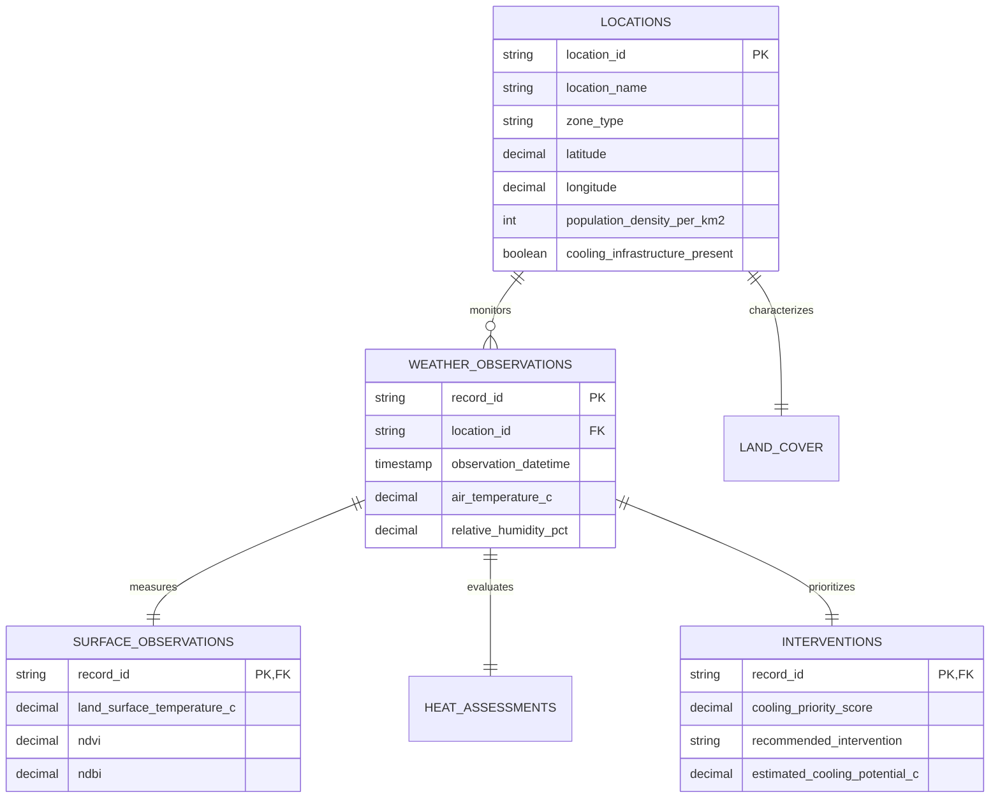

# HeatShield Project: Comprehensive Dataset & File Analysis Report

**Workspace Directory**: Repository Root (Relative: `Datasets/`)<br/>
**Study Domain**: Geospatial Urban Heat Exposure, Microclimate Dynamics & Cooling Prioritization  
**Target Geography**: Solapur Urban Agglomeration, Maharashtra, India (17.6120°N–17.7220°N, 75.8360°E–75.9620°E)  
**Observation Window**: 2021-01-01 to 2025-12-31 (5-Year Longitudinal Simulation)  
**Analysis Date**: October 2026  

---

## 1. Executive Summary

The workspace contains **HeatShield**, an academic data engineering, exploratory data analysis (EDA), and relational database (DBMS) project designed for a B.Tech Semester III curriculum. The dataset computationally simulates urban microclimate conditions, remote sensing indices, human thermal exposure, and urban heat mitigation interventions across **100 monitoring sites** and **9 urban morphological zones** in Solapur, Maharashtra.

The folder contains **18 files** (8 root data/documentation/code files and 10 high-resolution analytical charts) totaling approximately **126.8 MB**.

### Core Strengths
- **100% Data Completeness**: Exactly 150,000 observation rows with zero missing values or corrupt records across all 57 features.
- **Physical & Meteorological Coherence**: Strict adherence to atmospheric thermodynamics ($T_{min} \le T_{air} \le T_{max}$), expected biophysical correlations (NDVI vs. LST $r = -0.307$, NDBI vs. LST $r = +0.369$), and realistic seasonal variations.
- **Strict 3NF Normalization**: Clean separation between geospatial dimensions, meteorological facts, remote sensing observations, and planning interventions.
- **Production-Ready Visualizations**: 10 presentation-grade, publication-ready 300 dpi figures covering distribution, correlation, spatial hotspots, and executive dashboards.

---

## 2. Complete File Inventory

| File / Directory Name | Category | File Size | Format | Primary Role / Description |
|---|---|---|---|---|
| [`Heat Shield Master Dataset.csv`](../datasets/Heat%20Shield%20Master%20Dataset.csv) | Primary Dataset | 62.95 MB | CSV (UTF-8) | Denormalized flat master table containing 150,000 observations × 57 columns. |
| [`Heat Shield Locations.csv`](../datasets/Heat%20Shield%20Locations.csv) | Dimension Data | 13.1 KB | CSV (UTF-8) | Normalized geospatial dimension table for 100 unique monitoring stations across 9 zones. |
| [`Heat Shield Weather Data.csv`](../datasets/Heat%20Shield%20Weather%20Data.csv) | Fact Data | 19.06 MB | CSV (UTF-8) | Meteorological fact table with 150,000 rows × 18 atmospheric columns. |
| [`Heat Shield Surface Observations.csv`](../datasets/Heat%20Shield%20Surface%20Observations.csv) | Fact Data | 16.10 MB | CSV (UTF-8) | Remote sensing / land surface temperature fact table with 150,000 rows × 15 columns. |
| [`Heat Shield Interventions.csv`](../datasets/Heat%20Shield%20Interventions.csv) | Fact Data | 19.23 MB | CSV (UTF-8) | Planning, exposure risk, and intervention prioritization fact table with 150,000 rows × 11 columns. |
| [`Heat Shield Dictionary.xlsx`](../datasets/Heat%20Shield%20Dictionary.xlsx) | Metadata | 13.0 KB | XLSX | Dual-sheet workbook detailing column definitions, formulas, and 3NF target schemas. |
| [`Heat Shield Database Schema.sql`](../database/Heat%20Shield%20Database%20Schema.sql) | DDL / SQL | 18.0 KB | SQL Script | MySQL 8.0+ and PostgreSQL 14+ DDL, B-tree indexes, ETL insert scripts, and analytical queries. |
| [`Heat Shield Validation Report.txt`](Heat%20Shield%20Validation%20Report.txt) | QA / Audit Log | 8.5 KB | Plain Text | Automated 12-section validation report confirming range checks and statistical distributions. |
| [`Heat Shield Project ReadMe File.md`](../database/README.md) | Documentation | 15.4 KB | Markdown | Comprehensive technical documentation, project overview, and reproduction guide. |
| [`charts/`](../charts/) | Visualizations | 6.4 MB | Directory | Directory containing 10 high-resolution analytical figures (PNG format). |

---

## 3. Deep-Dive Data Architecture Analysis

### A. Master Dataset (`Heat Shield Master Dataset.csv`)
- **Dimensions**: 150,000 rows × 57 columns (62.95 MB).
- **Row Budget Check**: 150,000 rows fits cleanly inside Microsoft Excel's hard limit of 1,048,576 rows.
- **Thematic Breakdown**:
  1. **Record & Temporal Identifiers (10 columns)**: `record_id` (`HS-YYYY-NNNNNNN`), `location_id` (`SOL-LOC-001..100`), `observation_datetime` (ISO 8601 UTC), `observation_date`, `year` (2021–2025), `month` (1–12), `day` (1–31), `season` (Monsoon, Summer, Winter, Post-Monsoon), `data_source_type` (`Synthetic simulation`), `is_synthetic` (`TRUE`).
  2. **Geospatial & Topographic Context (10 columns)**: `city` (`Solapur`), `state` (`Maharashtra`), `country` (`India`), `latitude` (17.6120°–17.7220°N), `longitude` (75.8360°–75.9620°E), `location_name`, `zone_type` (9 typologies), `elevation_m` (449–477 m), `population_density_per_km2` (280–36,000), `distance_to_green_space_m` (0–2,500 m).
  3. **Meteorological / Atmospheric (10 columns)**: `air_temperature_c` (19.35°C–46.81°C), `max_air_temperature_c`, `min_air_temperature_c`, `relative_humidity_pct` (14.8%–98.0%), `wind_speed_mps` (0.5–14.0 m/s), `wind_direction_deg` (0°–359.9°), `solar_radiation_w_m2` (0–889 W/m²), `precipitation_mm` (0–19.9 mm), `cloud_cover_pct` (8.9%–95.5%), `atmospheric_pressure_hpa` (954.9–968.5 hPa).
  4. **Surface Temperature & Remote Sensing (13 columns)**: `land_surface_temperature_c` (17.06°C–55.35°C), `surface_temperature_anomaly_c` (-12.07°C to +10.45°C), `ndvi` (-0.12 to +0.76), `ndbi` (-0.36 to +0.65), `ndwi` (-0.33 to +0.56), `vegetation_cover_pct` (2.5%–95.0%), `impervious_surface_pct` (8.0%–95.0%), `building_density_index` (0.07–0.96), `road_density_km_per_km2` (3.0–32.0 km/km²), `tree_canopy_cover_pct` (0.8%–85.0%), `shade_availability_pct` (2.0%–65.7%), `surface_albedo` (0.06–0.27), `distance_to_water_m` (0–5,200 m).
  5. **Human Exposure & Vulnerability (7 columns)**: `pedestrian_activity_index` (11.5–88.0), `traffic_intensity_index` (18.0–92.0), `built_up_intensity_index` (8.0–94.8), `heat_exposure_index` (10.2–84.1), `vulnerable_population_index` (15.0–78.0), `cooling_infrastructure_present` (Boolean: 44% True, 56% False), `cooling_infrastructure_type` (Trees, Park, Shade Structure, Water, None).
  6. **Analytical Indices & Intervention Decision (7 columns)**: `urban_heat_island_intensity_c` (0.00°C–9.80°C), `heat_risk_category` (Low, Moderate, High, Very High), `shade_gap_index` (22.0–90.9), `green_cover_deficit_pct` (0.0%–92.9%), `cooling_priority_score` (13.5–89.3), `recommended_intervention` (9 actionable types), `estimated_cooling_potential_c` (0.35°C–4.05°C).

### B. Normalized Relational Subsets
The relational model splits the master flat table into distinct functional tables:



1. **`Heat Shield Locations.csv`** (100 rows × 15 columns):
   - Distribution across 9 zones: Residential (28), Commercial (14), Road (14), Industrial (12), Park (10), Educational (8), Transport (6), Waterbody (4), Open Land (4).
   - Serves as the primary parent table (`location_id` primary key).
2. **`Heat Shield Weather Data.csv`** (150,000 rows × 18 columns):
   - 100% 1-to-1 foreign key compliance with `Locations.csv`.
3. **`Heat Shield Surface Observations.csv`** (150,000 rows × 15 columns):
   - Contains all spectral indices, LST, and land cover percentages.
4. **`Heat Shield Interventions.csv`** (150,000 rows × 11 columns):
   - Combines public health risk categories with actionable cooling recommendations.

### C. Data Dictionary (`Heat Shield Dictionary.xlsx`)
- **Sheet 1 (`Data Dictionary`)**: 58 rows × 9 columns providing metadata for every attribute (Index, Name, Category, SQL Type, Unit, Valid Range, Description, Source Status, Assumptions).
- **Sheet 2 (`Normalization Schema`)**: 7 rows × 5 columns specifying the 3NF table design (`locations`, `weather_observations`, `surface_observations`, `land_cover`, `interventions`, `heat_assessments`).

---

## 4. Visualizations Portfolio (`charts/`)

All 10 charts are rendered at high resolution (3000 to 4200 px wide, 300 DPI) in PNG format:

| Chart File | Resolution | Key Analytical Visual Insight |
|---|---|---|
| [`01_temperature_distribution.png`](../charts/01_temperature_distribution.png) | 3000 × 1800 | Bimodal distributions comparing ambient air temperature ($\mu = 34.28^\circ\text{C}$) vs. land surface temperature ($\mu = 35.89^\circ\text{C}$, peak $55.35^\circ\text{C}$). |
| [`02_monthly_seasonal_trends.png`](../charts/02_monthly_seasonal_trends.png) | 3300 × 1800 | Monthly climatological progression showing extreme pre-monsoon heat spike in April–May and drop during Monsoon (July–August). |
| [`03_correlation_heatmap.png`](../charts/03_correlation_heatmap.png) | 3300 × 2700 | Pearson correlation matrix highlighting the negative cooling relationship of NDVI/vegetation and positive heating relationship of NDBI/impervious surface. |
| [`04_ndvi_vs_lst_scatter.png`](../charts/04_ndvi_vs_lst_scatter.png) | 3000 × 1800 | Hexbin/scatter plot demonstrating strong thermal suppression ($r = -0.31$) as vegetative density increases. |
| [`05_builtup_intensity_vs_lst.png`](../charts/05_builtup_intensity_vs_lst.png) | 3000 × 1800 | Relationship showing built-up intensity index driving surface heating up to $55^\circ\text{C}$. |
| [`06_heat_risk_distribution.png`](../charts/06_heat_risk_distribution.png) | 3600 × 1650 | Categorical breakdown across zones: High & Very High risks concentrated in Industrial, Commercial, and Road corridors. |
| [`07_geographic_hotspot_map.png`](../charts/07_geographic_hotspot_map.png) | 3000 × 2400 | Latitude/Longitude scatter plot of Solapur monitoring stations color-coded by mean LST and scaled by cooling priority. |
| [`08_cooling_priority_ranking.png`](../charts/08_cooling_priority_ranking.png) | 3300 × 2100 | Horizontal ranking of top 25 priority locations requiring immediate municipal cooling intervention. |
| [`09_location_zone_comparison.png`](../charts/09_location_zone_comparison.png) | 3300 × 1800 | Box plots comparing LST, shade gap, and UHI intensity across all 9 urban zones. |
| [`10_executive_summary_dashboard.png`](../charts/10_executive_summary_dashboard.png) | 4200 × 2700 | Comprehensive multi-panel executive dashboard summarizing high-level KPIs, spatial hotspots, and policy metrics. |

---

## 5. Identified Bugs, Inconsistencies & Improvement Opportunities

During the deep-dive analysis, several actionable defects and opportunities for improvement were identified:

### 1. SQL Syntax & Schema Error in `Heat Shield Database Schema.sql`
> [!WARNING]
> **Query 3 Syntax Error & Missing Column**:
> In line 416 of [`Heat Shield Database Schema.sql`](../database/Heat%20Shield%20Database%20Schema.sql):
> ```sql
> -- Existing Buggy Code:
> SELECT 
>     l.zone_type,
>     COUNT(DISTINCT l.location_id) AS total_locations,
>     ROUND(AVG(l.tree_canopy_cover_pct), 1) AS avg_existing_canopy_pct,
>     ...
> FROM locations l
> JOIN interventions i ON l.location_id = i.location_id
> GROUP l.zone_type   -- BUG: Missing 'BY' keyword!
> ORDER BY avg_priority_score DESC;
> ```
> - **Issue 1**: `GROUP l.zone_type` is missing the `BY` keyword (`GROUP BY l.zone_type`).
> - **Issue 2**: `l.tree_canopy_cover_pct` does not exist in the `locations` table schema (defined in lines 119–137). It exists in `land_cover` (`base_tree_canopy_cover_pct`) or `surface_observations` (`tree_canopy_cover_pct`).

### 2. Discrepancy Between README Documentation and Actual Disk Files
- **File Names**: The README specifies snake_case lowercase names without spaces (e.g. `heatshield_master_dataset.csv`, `heatshield_locations.csv`, `heatshield_database_schema.sql`, `README.md`), but the physical files on disk use Title Case with spaces (`Heat Shield Master Dataset.csv`, `Heat Shield Locations.csv`, etc.).
- **Missing Scripts**: Section 2 & 7 of the README document three Python scripts:
  - `generate_heatshield_dataset.py`
  - `validate_heatshield_dataset.py`
  - `heatshield_eda.py`  
  None of these Python scripts currently exist in the folder.
- **Typo in Validation Report Filename**:
  The report is named `Heat Shield Vadilation Report.txt` (spelled "Vadilation" instead of "Validation").
- **Folder Name Typo**:
  The root directory is named `Datasets Imporvements` ("Imporvements" instead of "Improvements").

### 3. Normalization Table Export Completeness
- The schema and dictionary define **6 normalized tables**:
  1. `locations` (present as CSV)
  2. `weather_observations` (present as CSV)
  3. `surface_observations` (present as CSV)
  4. `interventions` (present as CSV)
  5. `land_cover` (not exported as a standalone CSV)
  6. `heat_assessments` (not exported as a standalone CSV; fields are merged into `Heat Shield Interventions.csv`)

### 4. Categorical String Parsing Caveat in Pandas
- In `Heat Shield Locations.csv` and `Heat Shield Master Dataset.csv`, the column `cooling_infrastructure_type` uses `'None'` as a literal category for locations where `cooling_infrastructure_present == False` (84,000 rows).
- In standard pandas, `pd.read_csv()` parses literal `'None'` as `NaN` unless `keep_default_na=False` is passed. Adding a note or replacing `'None'` with `'No Infrastructure'` or `'None/Absent'` prevents inadvertent null conversion.

---

## 6. Actionable Recommendations for Dataset Improvements

1. **Fix SQL Queries in Schema**:
   Update `Heat Shield Database Schema.sql` to fix Query 3 syntax (`GROUP BY`) and properly join `land_cover` to calculate average canopy cover.
2. **Standardize File Naming**:
   Optionally provide aliases or rename the files to match the canonical snake_case standard expected by automated pipelines and the README, and correct the "Vadilation" typo.
3. **Generate Missing Fact CSVs**:
   Export separate CSVs for `land_cover.csv` (100 rows) and `heat_assessments.csv` (150,000 rows) to fulfill 100% of the 3NF schema tables.
4. **Reconstruct / Include Pipeline Scripts**:
   Add the generation, validation, and EDA Python scripts so anyone cloning the repository can reproduce the entire pipeline deterministically.
