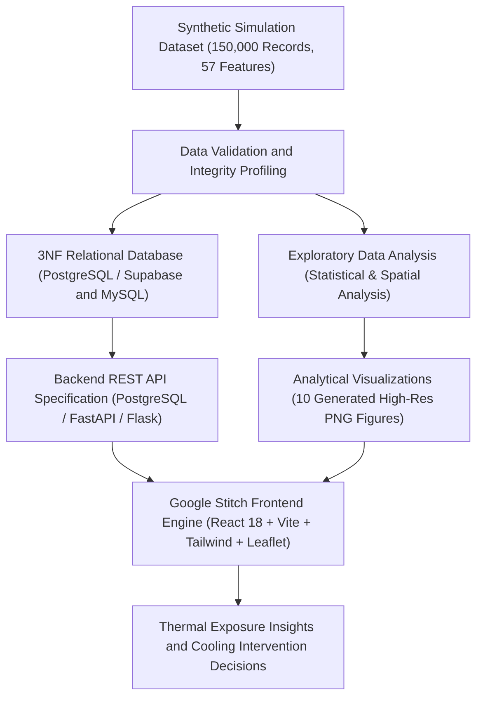

<p align="center">
  
  &nbsp;&nbsp;<b>Made For Indians — Made By Indians</b>&nbsp;&nbsp;
  
</p>

<p align="center">
  
</p>

<p align="center">
  
</p>

# HeatShield — Urban Heat Exposure Analysis and Cooling Intelligence Platform

[](#project-status-and-academic-context)
[](#team-name-members-and-work-distribution)
[](#database-design)
[](#dataset-and-data-integrity-disclosure)
[](#main-features)
[](#technology-stack)

---

## GitHub and Deployment Readiness

This repository is configured for professional GitHub collaboration and production-grade Vercel frontend deployment.

- **Frontend Core**: Repository root (`React 18 + Vite 5 + Tailwind CSS + Leaflet GIS + Recharts`).
- **Google Stitch Architecture**: Fully integrates 6 comprehensive telemetry pages and the interactive submission module conforming to Google Stitch research design specifications.
- **Vercel Readiness**: Configured for instant single-page application (SPA) deployment with deep routing support via [`vercel.json`](vercel.json).
- **Backend Status**: Focus is currently on the verified frontend and analytical data layers; Python Flask microservices and database ETL are documented and staged for subsequent milestone integration.
- **CI / Build Validation**: Production build validated cleanly via `npm run build` (`dist/` bundle tree-shaken and optimized).

---

## Team Name, Members, and Work Distribution

### Team Identifier: **TF-141**
**Institution**: MIT Vishwaprayag University (MIT-VPU), Solapur, Maharashtra, India  
**Course Track**: Semester III Integrated Project (FSD-1 + DBMS + EDADV)  
**Dedicated Team View**: Accessible directly inside the running application at [`/team`](src/pages/Team.jsx)

| Team Member | Student ID | Primary Academic Role | Key Deliverables & Responsibilities |
|---|---|---|---|
| **Furqan Bagwan** | `SCFU425004` | **Frontend Development (FSD-1)** | User interface architecture, Google Stitch component engineering, responsive page layouts, navigation paradigms, telemetry viewports, and visual presentation of heat findings. |
| **Aman Shaikh** | `SCFU425013` | **Exploratory Data Analysis & Visualization (EDADV)** | Dataset inspection, null-handling, statistical distributions, thermal correlation analysis, biophysical regressions (NDVI/NDBI vs. LST), and publication-ready charts. |
| **Bhavin Shankur** | `SCFU425014` | **Database Management & Backend (DBMS)** | 3NF relational schema design, PostgreSQL/Supabase and MySQL DDL migrations, spatial coordinate indexing, query optimization, and REST API architectural specifications. |

---

## Project Overview

HeatShield is an academic urban heat exposure analysis and cooling-intelligence platform developed for the **Solapur Urban Agglomeration, Maharashtra, India** (covering the simulation period 2021–2025). Built as an integrated Semester III capstone combining **Full Stack Development (FSD)**, **Database Management Systems (DBMS)**, and **Exploratory Data Analysis and Data Visualization (EDADV)**, HeatShield computationally organizes microclimate data, examines thermal exposure dynamics, and models cooling intervention priorities.

### The Problem HeatShield Addresses
Urban environments frequently experience pronounced spatial variations in temperature due to surface composition and human activity:
* **Thermal Disparities**: Densely built commercial and industrial sectors experience elevated land surface temperatures (LST) compared to vegetated areas.
* **Environmental Drivers**: Variations in vegetative density (NDVI), built-up surface intensity (NDBI), tree canopy coverage, surface albedo, and atmospheric radiation drive urban heat dynamics.
* **Decision Support**: Quantitative modeling of shade deficits, vegetative cover deficits, and exposure risks allows municipal planners to identify, evaluate, and prioritize potential cooling interventions.

> **Scope Clarification**: HeatShield is designed as a data-driven academic decision-support prototype. It is not an operational municipal emergency-alert system or a substitute for professional in-situ environmental monitoring.

---

## Table of Contents

- [Team Information](#team-name-members-and-work-distribution)
- [Project Overview](#project-overview)
- [Data Disclaimer](#dataset-and-data-integrity-disclosure)
- [Project Objectives](#project-objectives)
- [System Architecture](#architecture-overview)
- [Repository Structure](#repository-structure)
- [Main Features & Application Pages](#main-features--application-pages)
- [Database Design](#database-design)
- [Data Visualizations](#data-visualizations)
- [Technology Stack](#technology-stack)
- [Setup and Running Instructions](#setup-and-running-instructions)
- [Project Status & Academic Context](#project-status-and-academic-context)
- [Credits & License](#credits-and-academic-use)

---

## Dataset and Data Integrity Disclosure

> [!WARNING]
> **Data Disclaimer:** HeatShield currently uses a **synthetic academic simulation dataset for Solapur covering 2021–2025** (150,000 observation records across 100 monitoring sites). Its values are computationally simulated for educational and research prototyping. They are **not** official Indian Meteorological Department (IMD) station observations, verified satellite measurements, municipal sensor readings, or validated public health records.

Please note the following analytical boundaries:
* **Illustrative Results**: All charts, statistical metrics, and dashboard values reflect the patterns synthesized within the simulation dataset.
* **Correlation vs. Causation**: Statistical associations (such as inverse correlations between vegetation indices and surface temperatures) describe model relationships and do not independently establish real-world causality.
* **Model-Derived Priorities**: Multi-Criteria Decision Making (MCDM) Cooling Priority Scores and estimated cooling potential values (°C) are algorithmic estimates, not guaranteed field outcomes.
* **Monitoring Sites**: Geospatial coordinates (17.6120°N–17.7220°N, 75.8360°E–75.9620°E) represent representative simulated microclimate stations across Solapur's 9 urban zones and must be independently verified prior to real-world deployment.

---

## Project Objectives

1. **Quantify Thermal Patterns**: Analyze ambient air temperature ($T_{air}$) and land surface temperature ($LST$) dynamics across diurnal and seasonal cycles.
2. **Examine Environmental Correlates**: Evaluate relationships between thermal metrics and biophysical indicators (NDVI, NDBI, NDWI, tree canopy cover %, impervious surface %, and solar radiation).
3. **Zone-Based Thermal Comparison**: Contrast heat exposure across 9 urban morphological zones in Solapur (Residential, Commercial, Industrial, Road Corridors, Parks, Educational, Transport, Waterbodies, and Open Land).
4. **Thermal Risk Classification**: Categorize locations into standardized public health heat-risk tiers (Low, Moderate, High, Very High) using multi-variable exposure logic.
5. **Mitigation Prioritization**: Identify high-priority candidate zones for targeted interventions (e.g., urban afforestation, reflective cool roofs, shaded pedestrian transit corridors) based on calculated Shade Gap and Cooling Priority Scores.
6. **Accessible Visual Communication**: Present findings through clear, publication-quality visualizations and an interactive web interface conforming to Google Stitch research guidelines.
7. **Demonstrate Academic Full-Stack Integration**: Integrate 3NF relational database models, rigorous statistical data science, and modern web engineering into an end-to-end curriculum project.

---

## Architecture Overview

The platform is designed around a structured data pipeline separating raw simulations, relational facts, statistical analysis, and interactive user interfaces:



---

## Repository Structure

```
TF-141-Heatshield/
├── README.md                                          # Root project documentation and architectural guide
├── index.html                                         # Single-page application entry point
├── package.json                                       # Project manifest, dependencies, and build scripts
├── postcss.config.js                                  # PostCSS configuration with Tailwind and Autoprefixer
├── tailwind.config.js                                 # Google Stitch color tokens, typography & spacing
├── vite.config.js                                     # Vite 5 bundler configuration with dependency optimizer
├── vercel.json                                        # Vercel deployment rewrite rules for SPA routing
│
├── Banner & Logo/                                     # Visual brand assets
│   ├── heatshield-icon.svg                            # Application vector icon
│   ├── heatshield-logo-primary.svg                    # Primary brand logo
│   ├── heatshield-github-banner.png                   # Repository header card
│   └── heatshield-website-banner.png                  # Dashboard web banner
│
├── Website Design Files/                              # Google Stitch design references & exports
│   ├── heat_shield_team_page/                         # Stitch Team & Project specifications
│   │   ├── DESIGN.md                                  # Style tokens, design rules, and typography
│   │   ├── code.html                                  # Reference semantic HTML and classes
│   │   └── screen.png                                 # Visual design snapshot
│   ├── heatshield_overview_research/                  # Overview / Home design specifications
│   ├── heatshield_heat_analytics_dashboard/           # Dashboard design specifications
│   ├── heatshield_geographic_heat_map/                # GIS Heat Map design specifications
│   ├── heatshield_data_explorer/                      # Data Explorer design specifications
│   ├── heatshield_research_methodology/               # Research Methodology design specifications
│   └── heatshield_submit_reading/                     # Submit Reading modal/page design specifications
│
├── src/                                               # React frontend application source code
│   ├── main.jsx                                       # React DOM root entry point
│   ├── App.jsx                                        # React Router v6 route configuration
│   ├── index.css                                      # Tailwind directives and custom scrollbar/Leaflet theme
│   │
│   ├── pages/                                         # Core application views (Google Stitch)
│   │   ├── Home.jsx                                   # Overview: Mission, quick metrics & telemetry
│   │   ├── Dashboard.jsx                              # Analytics: Recharts diurnal curves & zone breakdown
│   │   ├── IndiaHeatMap.jsx                           # Geographic: Leaflet interactive GIS microclimate map
│   │   ├── ExploreData.jsx                            # Explorer: Filterable tabular ledger with CSV export
│   │   ├── Methodology.jsx                            # Science: UHI formulation, parameters & BibTeX citation
│   │   ├── Team.jsx                                   # Contributors: TF-141 profiles, roles & stack
│   │   └── SubmitReading.jsx                          # Contribution: In-situ community reading submission
│   │
│   ├── components/
│   │   ├── layout/                                    # Global structural layout components
│   │   │   ├── Navbar.jsx                             # Fixed top navigation header with active state
│   │   │   ├── Sidebar.jsx                            # Responsive slide-over mobile drawer navigation
│   │   │   └── PageLayout.jsx                         # Main page shell wrapping header, content & footer
│   │   ├── branding/                                  # Institutional identity components
│   │   │   ├── IndianFlag.jsx                         # "Made For Indians — Made By Indians" badge
│   │   │   └── ProjectFooter.jsx                      # Universal 4-column footer with provenance notice
│   │   ├── common/                                    # Shared utility UI components
│   │   │   └── ErrorBoundary.jsx                      # Graceful telemetry runtime error boundary
│   │   ├── map/                                       # Leaflet GIS mapping components
│   │   │   ├── HeatMap.jsx                            # 2D interactive map container
│   │   │   ├── HeatMapLegend.jsx                      # Temperature gradient key
│   │   │   └── TemperaturePopup.jsx                   # Monitoring site telemetry popover
│   │   └── dashboard/                                 # Analytics widgets & telemetry charts
│   │
│   └── data/                                          # Curated telemetry datasets & mock feeds
│
└── Datasets/                                          # Project data assets & analytical figures
    ├── datasets/                                      # Master simulation tables (150,000 rows × 57 cols)
    ├── database/                                      # PostgreSQL and MySQL 3NF relational schemas
    ├── charts/                                        # 10 publication-quality analytical figures (300 DPI)
    └── reports/                                       # Mathematical QA audits & validation reports
```

---

## Main Features & Application Pages

The HeatShield frontend implements a research-grade editorial design system adhering to the **Google Stitch** aesthetic:

### 1. Overview (`/`)
* **Core Academic Mission**: High-level problem statement and academic context for Solapur microclimate research.
* **Telemetry Metric Strip**: Key statistical aggregations (Average Air Temp $34.3^\circ\text{C}$, Peak LST $55.4^\circ\text{C}$, Active Simulation Stations $100$).
* **Recent Readings**: Live simulation feeds showcasing localized monitoring node observations.

### 2. Analytics Dashboard (`/dashboard`)
* **Diurnal Thermal Progression**: Interactive time-series charts illustrating peak daytime surface heating vs. ambient air cooling.
* **Morphological Zone Contrast**: Comparative bar and box plots contrasting High-Risk industrial corridors against low-stress vegetated zones.
* **Intervention Priorities**: Algorithmic cooling priority rankings mapping shade gaps to mitigation actions.

### 3. Geographic Heat Map (`/heat-map`)
* **Interactive Leaflet GIS**: Custom CartoDB-inspired tile styling with responsive pan/zoom over Solapur's urban footprint (`17.6599° N, 75.9064° E`).
* **Station Node Inspection**: Clickable monitoring markers revealing live microclimate metrics, NDVI, shade deficit, and cooling scores.
* **Thermal Stress Legend**: Explicit color ramps mapping temperatures from baseline green ($<30^\circ\text{C}$) to critical vermilion ($>45^\circ\text{C}$).

### 4. Data Explorer (`/explore-data`)
* **Multi-Parameter Search & Filters**: Filter 100+ monitoring sites by urban zone typology, heat risk tier, or keyword.
* **Metric Sorting**: Real-time sorting by air temperature, LST, vegetation cover, or cooling priority score.
* **CSV Export**: One-click download of filtered records for external analytical research.

### 5. Methodology & Simulation Specifications (`/methodology`)
* **Mathematical Formulations**: Equations defining Land Surface Temperature (LST), Urban Heat Island (UHI) intensity, and Shade Gap Index.
* **Simulation Boundaries**: Explicit documentation of the synthetic model assumptions (2021–2025).
* **Academic Citation**: Pre-formatted BibTeX citation for scholarly attribution.

### 6. Team & Project Information (`/team`)
* **Team TF-141 Roster**: Complete profiles for Furqan Bagwan (`SCFU425004`), Aman Shaikh (`SCFU425013`), and Bhavin Shankur (`SCFU425014`).
* **Workstream Architecture**: Detailed breakdown of responsibilities across Frontend (FSD-1), Data Science (EDADV), and Database Engineering (DBMS).
* **System Pipeline**: Visual 5-stage workflow diagram tracking data from synthetic generation to cooling policy scores.
* **Academic Scope & Provenance Disclosure**: Prominent institutional transparency card for MIT Vishwaprayag University.

### 7. Submit In-Situ Reading (`/submit-reading`)
* **Community Data Contribution**: Structured input form allowing contributors to submit local temperature, humidity, and location readings.
* **Client-Side Validation**: Ensures thermodynamic bounds and coordinate boundaries are preserved before entry staging.

---

## Database Design

The relational model implements a **Third Normal Form (3NF)** architecture designed to eliminate data redundancy while supporting performant time-series and spatial queries.

### Entity Relationship Model

| Entity Table | Classification | Primary Key | Foreign Keys | Row Count | Purpose |
|---|---|---|---|---|---|
| [`locations`](Datasets/database/heatshield_schema_postgres.sql#L72-L96) | Spatial Dimension | `location_id` | — | 100 | Static geographic monitoring site metadata, coordinates, elevation, population density, and zone type. |
| [`land_cover`](Datasets/database/heatshield_schema_postgres.sql#L104-L121) | Morphological Baseline | `location_id` | `location_id` $\rightarrow$ `locations` | 100 | Static biophysical site attributes (baseline vegetation %, impervious %, tree canopy %, albedo). |
| [`weather_observations`](Datasets/database/heatshield_schema_postgres.sql#L129-L157) | Meteorological Fact | `record_id` | `location_id` $\rightarrow$ `locations` | 150,000 | Time-series atmospheric observations (air temperature, humidity, wind, solar radiation, pressure). |
| [`surface_observations`](Datasets/database/heatshield_schema_postgres.sql#L165-L188) | Remote Sensing Fact | `record_id` | `record_id` $\rightarrow$ `weather_observations` | 150,000 | Remote sensing skin temperature (LST), spectral indices (NDVI, NDBI, NDWI), and shade availability. |
| [`heat_assessments`](Datasets/database/heatshield_schema_postgres.sql#L196-L213) | Thermal Risk Fact | `record_id` | `record_id` $\rightarrow$ `weather_observations` | 150,000 | Calculated UHI intensity, Heat Exposure Index, and public health risk categories. |
| [`interventions`](Datasets/database/heatshield_schema_postgres.sql#L221-L242) | Decision Fact | `record_id` | `record_id` $\rightarrow$ `weather_observations` | 150,000 | Shade Gap Index, Cooling Priority Score, recommended intervention, and estimated cooling potential. |

### Schema Scripts
* **PostgreSQL / Supabase**: [`Datasets/database/heatshield_schema_postgres.sql`](Datasets/database/heatshield_schema_postgres.sql)  
  *Utilizes `TIMESTAMPTZ`, check constraints, composite unique index on `(location_id, observation_datetime)`, and statistical `MODE() WITHIN GROUP` aggregations.*
* **MySQL 8.0+**: [`Datasets/database/heatshield_schema_mysql.sql`](Datasets/database/heatshield_schema_mysql.sql)  
  *Utilizes `DATETIME`, backtick-escaped identifiers, explicit foreign keys, and CTE-based analytical queries.*
* **Master Unified Reference**: [`Datasets/database/Heat Shield Database Schema.sql`](Datasets/database/Heat%20Shield%20Database%20Schema.sql)

---

## Data Visualizations

The project contains 10 presentation-grade analytical figures rendered at high resolution (300 DPI, up to 4200 px wide) located in [`Datasets/charts/`](Datasets/charts/):

| Figure | Chart File | Core Analytical Finding |
|---|---|---|
| **01** | [`01_temperature_distribution.png`](Datasets/charts/01_temperature_distribution.png) | Bimodal distribution contrasting ambient air temperature ($\mu = 34.28^\circ\text{C}$) vs. land surface temperature ($\mu = 35.89^\circ\text{C}$, max $55.35^\circ\text{C}$). |
| **02** | [`02_monthly_seasonal_trends.png`](Datasets/charts/02_monthly_seasonal_trends.png) | Annual thermal trajectory showing severe pre-monsoon heat peaks (April–May) and seasonal drops during July–August. |
| **03** | [`03_correlation_heatmap.png`](Datasets/charts/03_correlation_heatmap.png) | Pearson correlation matrix highlighting the negative cooling effect of NDVI ($r = -0.31$) and heating effect of NDBI ($r = +0.37$). |
| **04** | [`04_ndvi_vs_lst_scatter.png`](Datasets/charts/04_ndvi_vs_lst_scatter.png) | Hexbin/scatter distribution showing surface temperature moderation as vegetative density increases. |
| **05** | [`05_builtup_intensity_vs_lst.png`](Datasets/charts/05_builtup_intensity_vs_lst.png) | Scatter analysis showing higher built-up density indices driving surface heat concentrations. |
| **06** | [`06_heat_risk_distribution.png`](Datasets/charts/06_heat_risk_distribution.png) | Categorical breakdown demonstrating that High and Very High thermal risk tiers concentrate in Industrial and Commercial corridors. |
| **07** | [`07_geographic_hotspot_map.png`](Datasets/charts/07_geographic_hotspot_map.png) | Spatial map of Solapur coordinates color-coded by mean LST and sized by MCDM cooling priority score. |
| **08** | [`08_cooling_priority_ranking.png`](Datasets/charts/08_cooling_priority_ranking.png) | Ranked horizontal prioritization of the top 25 urban sites requiring municipal cooling intervention. |
| **09** | [`09_location_zone_comparison.png`](Datasets/charts/09_location_zone_comparison.png) | Multi-attribute box plots comparing LST, shade deficits, and UHI intensity across all 9 urban zones. |
| **10** | [`10_executive_summary_dashboard.png`](Datasets/charts/10_executive_summary_dashboard.png) | Comprehensive multi-panel executive dashboard consolidating key findings, distributions, and policy metrics. |

---

## Technology Stack

The HeatShield platform is structured around verified and active technologies across data engineering, database management, and application development:

* **Frontend Web Application**:
  * **React 18** — Declarative component-based UI architecture.
  * **Vite 5** — High-performance frontend build tool with Esbuild pre-bundling.
  * **JavaScript (ES6+)** — Client-side interaction logic.
  * **Tailwind CSS v3** — Curated design tokens, responsive utilities, and clean planar cards.
  * **Recharts** — Responsive charting for diurnal and statistical distributions.
  * **Leaflet / React-Leaflet** — 2D geospatial map visualization over Solapur.
  * **Lucide React** — Modern UI iconography.
* **Data Engineering & Analysis**:
  * **Python (Pandas, NumPy)** — Dataset synthesis, cleaning, validation checks, and feature derivation.
  * **Matplotlib & Seaborn** — Generation of 10 publication-quality analytical figures.
  * **OpenPyXL / Microsoft Excel** — Tabular data dictionary and schema documentation.
* **Database & Storage**:
  * **PostgreSQL 14+ / Supabase** — Production cloud relational database using strict relational constraints.
  * **MySQL 8.0+** — Secondary relational database alternative for standard academic RDBMS environments.
  * **Structured Query Language (SQL)** — 3NF DDL migrations, composite indexing, and 12 analytical query benchmarks.
* **Version Control & Deployment**:
  * **Git & GitHub** — Collaborative source code and document version control.
  * **Vercel** — Production static hosting with single-page application rewrites via `vercel.json`.

---

## Setup and Running Instructions

### 1. Prerequisites
* **Node.js 18+** and `npm` installed.
* **Python 3.9+** (for analytical scripts).
* **PostgreSQL 14+** (or Supabase) **OR** **MySQL 8.0+** (for relational database deployment).

---

### 2. Frontend Application Execution (React + Vite)

#### Standard Local Environment:
```bash
# 1. Install dependencies
npm install

# 2. Launch Vite development server
npm run dev
```
The application will launch and be accessible at **`http://localhost:3000/`**.

#### Production Build & Verification:
```bash
# Compile and optimize production bundle
npm run build

# Preview production build locally
npm run preview
```

---

### 3. Vercel Deployment Checklist

The frontend is ready for zero-configuration deployment to Vercel:

1. Import your GitHub repository (`TF-141-Heatshield`) into Vercel.
2. Select **Vite** as the Framework Preset.
3. Root Directory: `./` (repository root).
4. Build Command: `npm run build`
5. Output Directory: `dist`
6. Deploy. The included [`vercel.json`](vercel.json) automatically routes direct visits (e.g. `/team`, `/dashboard`, `/heat-map`) to `index.html` without 404 errors.

---

### 4. Database Deployment

#### Option A: PostgreSQL / Supabase
1. Connect to PostgreSQL or open the Supabase SQL Editor:
   ```bash
   psql -U postgres -d heatshield_db
   ```
2. Execute the migration script:
   ```bash
   psql -U postgres -d heatshield_db -f "Datasets/database/heatshield_schema_postgres.sql"
   ```
3. Load the master dataset into the staging table:
   ```sql
   \copy heatshield_master FROM 'Datasets/datasets/Heat Shield Master Dataset.csv' WITH (FORMAT csv, HEADER true);
   ```

#### Option B: MySQL 8.0+
1. Connect via MySQL Command Line:
   ```bash
   mysql -u root -p
   ```
2. Source the schema:
   ```sql
   CREATE DATABASE heatshield_db CHARACTER SET utf8mb4 COLLATE utf8mb4_unicode_ci;
   USE heatshield_db;
   SOURCE Datasets/database/heatshield_schema_mysql.sql;
   ```

---

## Project Status and Academic Context

* **Program**: B.Tech Semester III (Combined Academic Project)
* **Institution**: MIT Vishwaprayag University (MIT-VPU), Solapur
* **Course Modules**:
  * Full Stack Development (FSD-1)
  * Database Management Systems (DBMS)
  * Exploratory Data Analysis & Data Visualization (EDADV)
* **Current Status**:
  * ✅ Master synthetic simulation dataset (150,000 rows × 57 cols) generated and audited.
  * ✅ 12-section mathematical and physical QA validation passed.
  * ✅ Complete 3NF relational schemas implemented for PostgreSQL and MySQL.
  * ✅ 10 publication-quality analytical visualization figures created.
  * ✅ **Production-ready Google Stitch frontend complete**:
    - **Overview** (`/`)
    - **Analytics Dashboard** (`/dashboard`)
    - **Geographic Heat Map** (`/heat-map`)
    - **Data Explorer** (`/explore-data`)
    - **Methodology & Specifications** (`/methodology`)
    - **Team & Project Information** (`/team`)
    - **Submit Reading Form** (`/submit-reading`)
  * ✅ Production build verified (`npm run build` exit code `0`).
  * 🟡 Python Flask REST API backend specifications staged for subsequent milestone.

---

## Credits and Academic Use

HeatShield is an academic project developed by **Team TF-141**:
* **Furqan Bagwan** (`SCFU425004`) — Frontend Development (FSD-1)
* **Aman Shaikh** (`SCFU425013`) — Exploratory Data Analysis & Data Visualization (EDADV)
* **Bhavin Shankur** (`SCFU425014`) — Database Management & Backend (DBMS)

Developed for academic demonstration and research prototyping at **MIT Vishwaprayag University (MIT-VPU)**, Solapur, Maharashtra, India.

### License
Academic Open Science Prototype. Created for educational and research evaluation under the MIT Vishwaprayag University curriculum.
