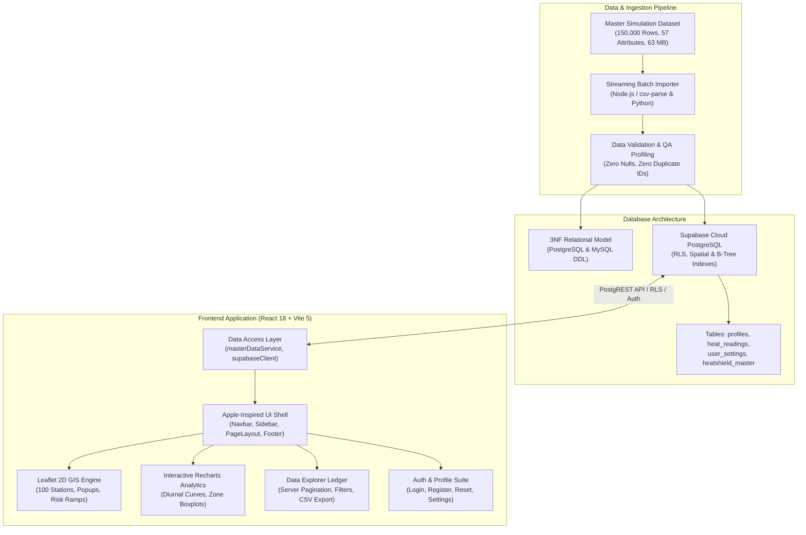

<p align="center">
  
  &nbsp;&nbsp;<b>Made For Indians — Made By Indians</b>&nbsp;&nbsp;
  
</p>

<p align="center">
  
</p>

<p align="center">
  
</p>

# HeatShield — Urban Heat Exposure Analysis and Cooling Intelligence Platform

[](#project-status-and-academic-context)
[](#team-name-members-and-work-distribution)
[](#database-design--supabase-cloud-architecture)
[-yellow.svg)](#dataset-and-data-integrity-disclosure)
[](#design-system-and-uiux-architecture)
[](#technology-stack)
[](#netlify-deployment)

---

## Executive Summary & Deployment Readiness

**HeatShield** is an academic urban microclimate intelligence platform engineered for the **Solapur Urban Agglomeration, Maharashtra, India** ($17.6120^\circ\text{N}$–$17.7220^\circ\text{N}$, $75.8360^\circ\text{E}$–$75.9620^\circ\text{E}$). Developed by **Team TF-141** as an integrated Semester III capstone project at **MIT Vishwaprayag University (MIT-VPU)**, the platform bridges **Full Stack Web Development (FSD-1)**, **Database Management Systems (DBMS)**, and **Exploratory Data Analysis and Data Visualization (EDADV)**.

The project combines an **Apple-inspired minimalist scientific design system** with a high-performance **Leaflet GIS mapping engine**, real-time **Supabase Cloud PostgreSQL** telemetry, and a **150,000-record biophysical simulation repository**.

### Repository Deployment Highlights
- **Production Frontend**: Built with React 18, Vite 5, Tailwind CSS, Leaflet 2D GIS, and Recharts. Validated cleanly via `npm run build` (`0` exit code, tree-shaken vendor chunks).
- **Apple-Inspired Design Language**: Complete UI redesign across all 14 routes adhering to Human Interface Guidelines (HIG) principles: quiet elegance, SF Pro typographic hierarchy, `#0071e3` Apple System Blue accents, generous whitespace, and scientific data density. (See [Design System Documentation](docs/design-research/apple-inspired-design-system.md)).
- **Cloud Database & Auth**: Supabase PostgreSQL backend with Row Level Security (RLS), email/password authentication, user profiles/settings, user-submitted readings, saved analyses, and a public read-only master relation.
- **GIS Mapping Engine**: Interactive Leaflet map rendering 100 synthetic station summaries with metric switching, filters, popups, and OpenStreetMap tiles.
- **High-Throughput Ingestion Pipelines**: Production-grade Node.js streaming parser (`csv-parse`, ~$140,000$ rows/sec validation) and Python batch upsert tools.
- **Honest Unavailable States**: Research summaries remain available from the bundled validated JSON; failed Supabase/API requests are not presented as live measurements.
- **Static Hosting**: Netlify, Vercel, and Render deployment configurations are maintained separately for the React/Vite single-page application.

---

## Team Name, Members, and Work Distribution

### Team Identifier: **TF-141**
**Institution**: MIT Vishwaprayag University (MIT-VPU), Solapur, Maharashtra, India  
**Course Track**: Semester III Integrated Project (FSD-1 + DBMS + EDADV)  
**Dedicated Application View**: Accessible at [`/team`](src/pages/Team.jsx)

| Team Member | Student ID | Academic Specialization | Core Deliverables & Architecture |
|---|---|---|---|
| **Furqan Bagwan** | `SCFU425004` | **Frontend Development (FSD-1)** | React 18 SPA architecture, Apple-inspired design tokens, component engineering, Leaflet GIS mapping integration, responsive navigation, authentication views, and interactive state management. |
| **Aman Shaikh** | `SCFU425013` | **Exploratory Data Analysis & Visualization (EDADV)** | Statistical profiling, null-audit, thermal distributions, correlation matrices ($r = -0.31$ for NDVI, $r = +0.37$ for NDBI), diurnal curve modeling, and 10 publication-quality analytical figures (300 DPI). |
| **Bhavin Shankur** | `SCFU425014` | **Database Management & Backend (DBMS)** | 3NF relational schema specification (PostgreSQL & MySQL), Supabase cloud database architecture, Row Level Security (RLS) policies, B-tree/spatial indexing, and high-performance streaming batch CSV ingestion pipelines. |

---

## Table of Contents

1. [Project Overview & Objectives](#project-overview)
2. [Dataset & Data Integrity Disclosure](#dataset-and-data-integrity-disclosure)
3. [System Architecture](#system-architecture)
4. [Repository Structure](#repository-structure)
5. [Application Pages & Confirmed Features](#application-pages--confirmed-features)
6. [Design System & UI/UX Architecture](#design-system-and-uiux-architecture)
7. [Database Design & Supabase Cloud Architecture](#database-design--supabase-cloud-architecture)
8. [Master Dataset Integration & Ingestion Pipelines](#master-dataset-integration--ingestion-pipelines)
9. [Data Visualizations & Analytical Findings](#data-visualizations--analytical-findings)
10. [Technology Stack](#technology-stack)
11. [Setup and Local Development Guide](#setup-and-local-development-guide)
12. [Deployment Guide (Netlify, Vercel and Render)](#deployment-guide-netlify-vercel-and-render)
13. [Project Roadmap & Status](#project-roadmap--status)
14. [Credits and Academic Attribution](#credits-and-academic-attribution)

---

## Project Overview

Rapid urban densification has exacerbated localized heat retention across urban areas. The Solapur Urban Agglomeration presents distinct microclimatic challenges due to semi-arid climatic conditions, intense solar insolation, and varying land cover composition.

HeatShield computationally models and analyzes these thermal dynamics to provide municipal stakeholders and researchers with actionable cooling intelligence:

* **Quantifying Microclimate Disparities**: Analyzes ambient air temperature ($T_{air}$) and land surface temperature ($LST$) dynamics across diurnal and seasonal cycles.
* **Biophysical Correlation Modeling**: Evaluates the mitigating impact of vegetation indices (NDVI, tree canopy cover) against heat-amplifying factors (NDBI built-up index, impervious surface cover, albedo deficits).
* **Morphological Zone Contrast**: Compares thermal stress across 9 standardized urban zones: *Residential, Commercial, Industrial, Road Corridors, Parks, Educational, Transport, Waterbodies, and Open Land*.
* **Source Risk Labels**: Summarizes four labels present in the synthetic source records (*Low, Moderate, High, Very High*). Their thresholds and health-risk validity are not independently established.
* **Cooling Intervention Prioritization**: Calculates Shade Gap Indices and Multi-Criteria Decision Making (MCDM) Cooling Priority Scores to recommend targeted cooling solutions (urban afforestation, cool roofs, shaded transit corridors).

> [!NOTE]
> **Academic Scope Clarification:** HeatShield is an academic research and decision-support prototype. It does not replace operational municipal early-warning systems or certified ground-station instrumentation.

---

## Dataset and Data Integrity Disclosure

> [!WARNING]
> **Academic Simulation Disclosure:**
> HeatShield's master research dataset is **synthetic academic simulation data for Solapur covering 2021–2025** (150,000 records across 100 represented locations). The repository documents WRF-Chem, ERA5-Land, and IMD provenance, but those provenance claims have not been independently verified.
>
> They are **not** verified live readings from the Indian Meteorological Department (IMD), certified municipal sensor grids, or validated hospital heat-stroke records. Source-encoded risk labels are not independently validated health-risk classes.

### Analytical Boundaries
1. **Descriptive Associations**: Correlations summarize the synthetic records and do not establish causation or real environmental mechanisms.
2. **Unvalidated Labels and Scores**: Source risk labels and application-derived scores are descriptive fields, not official warnings or validated medical classifications.
3. **Represented Coordinates**: Map points represent the dataset's sampled coordinates only; they are not independently verified sensor sites or municipal boundaries.

---

## System Architecture

HeatShield decouples raw data ingestion, relational persistence, spatial telemetry, and client presentation into a resilient modular pipeline:



---

## Repository Structure

```
TF-141-Heatshield/
├── README.md                                          # Comprehensive project documentation (this file)
├── index.html                                         # Single-page application HTML5 entry point
├── package.json                                       # Project metadata, dependencies, and npm scripts
├── postcss.config.js                                  # PostCSS configuration with Tailwind and Autoprefixer
├── tailwind.config.js                                 # Apple-inspired design tokens, typography, radii & colors
├── vite.config.js                                     # Vite 5 configuration with manual vendor chunk optimizer
├── vercel.json                                        # Vercel deployment rewrite rules for SPA client routing
├── render.yaml                                        # Render blueprint configuration with security headers
├── .env.example                                       # Public environment variable template
├── .gitignore                                         # Production git ignore specification
│
├── docs/                                              # Engineering specifications and research documents
│   ├── MASTER_DATASET_IMPORT_GUIDE.md                 # 150k dataset schema mapping and batch import guide
│   └── design-research/
│       └── apple-inspired-design-system.md            # Apple website design system reverse-engineering report
│
├── scripts/                                           # Reusable ETL and data engineering utilities
│   ├── importMasterDataset.js                         # High-performance Node.js streaming CSV batch importer
│   ├── import_master_dataset.py                       # Python streaming batch CSV importer
│   └── generate_dashboard_data.py                     # Generates precomputed regional analytical aggregates
│
├── supabase/                                          # Supabase database configuration and migrations
│   ├── config.toml                                    # Local Supabase CLI configuration
│   ├── seed.sql                                       # Local development test seeds
│   └── migrations/
│       ├── 20261020000001_heatshield_backend.sql      # Profiles, heat_readings, user_settings, RLS policies
│       └── 20261020000002_heatshield_master.sql       # heatshield_master 57-column schema, indexes & SELECT grants
│
├── Banner & Logo/                                     # Visual brand assets (Git tracked)
│   ├── India's Flag.png                               # National emblem flag icon
│   ├── heatshield-icon.svg                            # Application vector mark
│   ├── heatshield-logo-primary.svg                    # Primary horizontal brand logo
│   ├── heatshield-github-banner.png                   # Repository header card
│   └── heatshield-website-banner.png                  # Dashboard header banner
│
├── Website Design Files/                              # Research wireframes and reference screenshots (Git tracked)
│
├── src/                                               # Frontend application source code
│   ├── main.jsx                                       # React DOM application mount point
│   ├── App.jsx                                        # React Router v6 routing table (14 active routes)
│   ├── index.css                                      # Apple typographic rules, scrollbar & Leaflet styles
│   │
│   ├── pages/                                         # Application page views
│   │   ├── Home.jsx                                   # Research overview, mission statement & key stats
│   │   ├── Dashboard.jsx                              # Analytics dashboard: Recharts diurnal curves & zone comparisons
│   │   ├── IndiaHeatMap.jsx                           # Interactive Leaflet GIS microclimate map
│   │   ├── ExploreData.jsx                            # 150k record tabular explorer with server pagination & filters
│   │   ├── Methodology.jsx                            # Scientific formulas, UHI equations, citation & parameters
│   │   ├── Team.jsx                                   # Team TF-141 profiles, work distribution & institutional credit
│   │   ├── Contact.jsx                                # Academic inquiry, institutional location & feedback form
│   │   ├── SubmitReading.jsx                          # In-situ community heat observation submission form
│   │   ├── Login.jsx                                  # Supabase user authentication login view
│   │   ├── Register.jsx                               # Researcher account registration with affiliation
│   │   ├── ForgotPassword.jsx                         # Email password reset request view
│   │   ├── ResetPassword.jsx                          # Secure password update view
│   │   ├── AuthCallback.jsx                           # OAuth and magic link token exchange handler
│   │   └── Profile.jsx                                # Researcher profile details, badges & user preferences
│   │
│   ├── components/                                    # Modular UI component library
│   │   ├── layout/                                    # Navbar, Sidebar, PageLayout shell
│   │   ├── branding/                                  # ProjectFooter with academic disclosure
│   │   ├── common/                                    # StatCard, LoadingState, EmptyState, ErrorState
│   │   └── map/                                       # Leaflet GIS components
│   │       ├── HeatShieldMap.jsx                      # Leaflet map container with CartoDB/OSM tiles
│   │       ├── HeatMapMarkers.jsx                     # High-performance CircleMarker layers
│   │       ├── HeatMapPopup.jsx                       # Academic telemetry popup with thermodynamic stats
│   │       ├── HeatMapLegend.jsx                      # Thermal risk color ramps & threshold chips
│   │       ├── HeatMapControls.jsx                    # Domain switcher (Solapur / National) & reset view
│   │       └── HeatMapIntensityLayer.jsx              # Semi-transparent thermal risk overlay
│   │
│   ├── context/                                       # Global React Context providers
│   │   └── AuthContext.jsx                            # Supabase authentication session & user profile state
│   │
│   ├── services/                                      # Data access layer & API services
│   │   ├── masterDataService.js                       # PostgREST query builder, pagination & filter service
│   │   ├── heatmapService.js                          # GeoJSON telemetry and station microclimate service
│   │   └── supabaseClient.js                          # Supabase singleton client with env validation
│   │
│   └── data/                                          # Bundled offline dataset fixtures
│       ├── solapurLocations.js                        # 100 Solapur microclimate station coordinates & specs
│       ├── dashboardData.js                           # Precomputed monthly & zone aggregates from 150k rows
│       └── indiaGridData.js                           # 54-station national thermal reanalysis grid
│
└── Datasets/                                          # Research dataset assets and analytical figures
    ├── datasets/                                      # Master simulation tables (Git-tracked schemas/dictionaries)
    ├── database/                                      # PostgreSQL and MySQL 3NF relational DDL scripts
    ├── charts/                                        # 10 publication-quality analytical figures (300 DPI)
    └── reports/                                       # Mathematical validation & statistical audit reports
```

---

## Application Pages & Confirmed Features

The routes declared in [`src/App.jsx`](src/App.jsx) are organized into Public Research, Analytical Explorer, Protected Telemetry, and Authentication workflows. Protected routes continue to use the existing auth guard; unknown paths redirect to the home route.

### 1. Research Overview (`/`)
- **Editorial Hero**: Apple-style typography highlighting Solapur's urban heat challenges and platform capabilities.
- **Telemetry Metric Strip**: Key statistical summaries ($34.3^\circ\text{C}$ Mean Air Temp, $55.4^\circ\text{C}$ Peak LST, $100$ Active Stations, $150,000$ Observation Records).
- **Recent Telemetry Stream**: Real-time simulation stream displaying localized monitoring node observations and anomalies.
- **Academic Mission Callout**: Clear statement of academic purpose and simulation boundaries.

### 2. Analytics Dashboard (`/dashboard`)
- **Validated Research Summary**: Displays static EDADV summaries derived from the synthetic academic dataset with clear provenance and interpretation limits.
- **Separate Optional Live API Panel**: Shows live values only when a configured API explicitly identifies the response as live; otherwise it presents an unavailable or unconfigured state.

### 3. Geographic Heat Map (`/heat-map`)
- **Leaflet 2D GIS Engine**: Custom CartoDB-styled base tiles with smooth pan/zoom over Solapur (`17.6599° N, 75.9064° E`).
- **100 Synthetic Station Summaries**: CircleMarkers represent sampled coordinates and synthetic station means, not verified sensors.
- **Station Popups**: Show available summary fields and sample counts with simulation provenance.
- **Metric and Station Filters**: Switch air-temperature/LST styling and filter represented stations.

### 4. Data Explorer (`/explore-data`)
- **150,000 Record Supabase Integration**: Real-time querying against `public.heatshield_master` via PostgREST.
- **Server-Side Pagination**: Queries the existing `public.heatshield_master` relation in bounded pages.
- **Zone and Risk Filters**: Filters the source records by zone and source-encoded risk label; identifier search uses station/record ID prefixes.
- **Visible-Row CSV Export**: Exports only rows currently displayed by the table.
- **Honest Unavailable State**: A failed master query is not replaced by station fixtures or represented as a successful live response.

### 5. Methodology & Simulation Specifications (`/methodology`)
- **Thermodynamic Equations**: Documented mathematical formulations for Land Surface Temperature (LST), Urban Heat Island (UHI) intensity, and Shade Gap Index.
- **Model Physics & Boundaries**: Repository provenance references WRF-Chem and ERA5-Land; those claims have not been independently verified. Results remain synthetic and descriptive.
- **Scholarly Citation**: Pre-formatted BibTeX citation block for academic attribution.

### 6. Team & Work Distribution (`/team`)
- **Team TF-141 Profiles**: Detailed member cards for Furqan Bagwan, Aman Shaikh, and Bhavin Shankur with student IDs and academic specializations.
- **5-Stage Pipeline Diagram**: End-to-end data flow visualization from raw simulation to cooling policy decisions.
- **Academic Provenance Notice**: Institutional affiliation card for MIT Vishwaprayag University.

### 7. Contact & Collaboration (`/contact`)
- **Inquiry Channels**: Dedicated academic research and municipal collaboration contact points.
- **Form Validation**: Interactive feedback form with client-side field validation and confirmation states.
- **Institutional Location**: Physical address and department details at MIT-VPU, Solapur.

### 8. Submit In-Situ Reading (`/submit-reading`)
- **Community Telemetry Input**: Form allowing authorized contributors to submit localized microclimate observations.
- **Boundary Validation**: Real-time validation verifying thermodynamic bounds and coordinate boundaries.
- **Supabase Cloud Submission**: Direct insert into `public.heat_readings` with user ID attribution.

### 9. Authentication & Researcher Profile Suite
- **Login (`/login`)**: Secure Supabase email/password authentication and Google OAuth provider support.
- **Register (`/register`)**: Account creation with student/researcher affiliation and password strength validation.
- **Forgot Password (`/forgot-password`)**: Automated password reset request via email magic link.
- **Reset Password (`/reset-password`)**: Secure recovery token verification and password update form.
- **Auth Callback (`/auth/callback`)**: Dedicated route for OAuth token exchange and session confirmation.
- **Researcher Profile (`/profile`)**: User profile management, role badges, contribution counts, and UI preferences.

---

## Design System and UI/UX Architecture

The HeatShield interface implements an **Apple-inspired minimalist scientific design system**, reverse-engineered from Apple's design language and documented in [`docs/design-research/apple-inspired-design-system.md`](docs/design-research/apple-inspired-design-system.md).

### Design Philosophy
- **Restraint and Focus**: Generous breathing space, high contrast, and zero unnecessary visual ornamentation.
- **Human Interface Typography**: System-native font stack prioritizing legibility, precise line heights, and negative letter spacing on headlines.
- **Quiet Surfaces**: Soft `#fafafc` canvas backgrounds paired with clean `#ffffff` card elevations and subtle hairline borders.
- **Purposeful Color Semantics**: Apple System Blue (`#0071e3`) for primary actions; an intuitive 4-tier thermal risk ramp for scientific data.

### Design Tokens Summary

| Token Type | Value / Specification | Usage Context |
|---|---|---|
| **Canvas Background** | `#fafafc` (Off-white canvas) | Page background, body canvas |
| **Card / Surface** | `#ffffff` (Pure white) | Telemetry cards, tables, modals, drawers |
| **Dark Section** | `#000000` / `#1d1d1f` | Editorial high-impact callout cards |
| **Primary Text** | `#1d1d1f` (92% Black) | Headlines, body copy, active navigation |
| **Secondary Text** | `#86868b` (Muted gray) | Subtitles, metadata, table headers, labels |
| **Accent Color** | `#0071e3` (Apple System Blue) | Primary action buttons, active tabs, links |
| **Hairline Border** | `#d2d2d7` / `#e5e5ea` / `#f5f5f7` | Subtle 1px dividers, table borders, card outlines |
| **Thermal Low Risk** | `#059669` (Emerald 600) | Normal microclimate conditions ($<30^\circ\text{C}$) |
| **Thermal Moderate** | `#d97706` (Amber 600) | Caution thermal conditions ($30^\circ\text{C}$–$35^\circ\text{C}$) |
| **Thermal High Risk** | `#ea580c` (Orange 600) | Elevated thermal stress ($35^\circ\text{C}$–$40^\circ\text{C}$) |
| **Thermal Very High** | `#dc2626` (Red 600) | Severe heat stress conditions ($>40^\circ\text{C}$) |
| **Card Radius** | `24px`–`28px` (`rounded-3xl`) | Telemetry cards, charts, map containers |
| **Pill Radius** | `9999px` (`rounded-full`) | Action buttons, risk badges, filter chips |
| **Control Radius** | `12px`–`14px` (`rounded-xl`) | Form inputs, select dropdowns, search bars |
| **Font Stack** | `-apple-system, BlinkMacSystemFont, "SF Pro Display", "SF Pro Text", "Helvetica Neue", Arial, sans-serif` | Project-wide typography |
| **Monospace Stack** | `SF Mono, Menlo, Monaco, Consolas, monospace` | Telemetry figures, coordinates, code blocks |

---

## Database Design & Supabase Cloud Architecture

HeatShield operates on a dual-layer database architecture: an academic **Third Normal Form (3NF)** relational model for theoretical rigor, and a live **Supabase PostgreSQL Cloud Repository** serving high-concurrency analytical queries.

### 1. 3NF Relational Model (Academic Specification)

The 3NF schema eliminates data redundancy and guarantees analytical referential integrity across dimensional and fact entities:

| Entity Table | Classification | Primary Key | Foreign Keys | Row Count | Purpose |
|---|---|---|---|---|---|
| [`locations`](Datasets/database/heatshield_schema_postgres.sql#L72-L96) | Spatial Dimension | `location_id` | — | 100 | Static geographic monitoring site metadata, coordinates, elevation, population density, and zone type. |
| [`land_cover`](Datasets/database/heatshield_schema_postgres.sql#L104-L121) | Morphological Baseline | `location_id` | `location_id` $\rightarrow$ `locations` | 100 | Static biophysical site attributes (baseline vegetation %, impervious %, tree canopy %, albedo). |
| [`weather_observations`](Datasets/database/heatshield_schema_postgres.sql#L129-L157) | Meteorological Fact | `record_id` | `location_id` $\rightarrow$ `locations` | 150,000 | Time-series atmospheric observations (air temperature, humidity, wind, solar radiation, pressure). |
| [`surface_observations`](Datasets/database/heatshield_schema_postgres.sql#L165-L188) | Remote Sensing Fact | `record_id` | `record_id` $\rightarrow$ `weather_observations` | 150,000 | Remote sensing skin temperature (LST), spectral indices (NDVI, NDBI, NDWI), and shade availability. |
| [`heat_assessments`](Datasets/database/heatshield_schema_postgres.sql#L196-L213) | Thermal Risk Fact | `record_id` | `record_id` $\rightarrow$ `weather_observations` | 150,000 | Calculated UHI intensity, Heat Exposure Index, and public health risk categories. |
| [`interventions`](Datasets/database/heatshield_schema_postgres.sql#L221-L242) | Decision Fact | `record_id` | `record_id` $\rightarrow$ `weather_observations` | 150,000 | Shade Gap Index, Cooling Priority Score, recommended intervention, and estimated cooling potential. |

### 2. Operational Supabase Cloud Schema & Migrations

The live Supabase cloud database is managed via SQL migrations located in [`supabase/migrations/`](supabase/migrations/):

* **Migration 1: Core User & Community Telemetry** ([`20261020000001_heatshield_backend.sql`](supabase/migrations/20261020000001_heatshield_backend.sql))
  * `public.profiles`: User profile extensions linked to `auth.users` with cascading triggers.
  * `public.heat_readings`: In-situ community temperature and microclimate submissions.
  * `public.user_settings`: User theme, telemetry preferences, and regional notification tolerances.
  * **Security**: Row Level Security (RLS) policies guaranteeing users can only modify their own profiles and readings.
* **Migration 2: Master Observation Repository** ([`20261020000002_heatshield_master.sql`](supabase/migrations/20261020000002_heatshield_master.sql))
  * `public.heatshield_master`: Consolidated 57-column observation table storing the complete 150,000-record Solapur dataset.
  * **Primary Key**: `record_id` (`BIGINT`) with unique constraint.
  * **Compound & Spatial Indexes**:
    * `idx_heatshield_master_loc_time` on `(location_id, observation_datetime DESC)`
    * `idx_heatshield_master_zone_risk` on `(zone_name, heat_risk_category)`
    * `idx_heatshield_master_air_temp` on `(air_temperature_c)`
    * `idx_heatshield_master_lst` on `(lst_celsius)`
    * `idx_heatshield_master_coords` on `(latitude, longitude)`
  * **Access Control**: Public `SELECT` granted to `anon` and `authenticated` roles for read-only query access from the client frontend; `INSERT`, `UPDATE`, and `DELETE` strictly restricted to `service_role`.

### 3. Schema DDL Reference Scripts
* **PostgreSQL / Supabase 3NF DDL**: [`Datasets/database/heatshield_schema_postgres.sql`](Datasets/database/heatshield_schema_postgres.sql)
* **MySQL 8.0+ 3NF DDL**: [`Datasets/database/heatshield_schema_mysql.sql`](Datasets/database/heatshield_schema_mysql.sql)
* **Unified Reference Schema**: [`Datasets/database/Heat Shield Database Schema.sql`](Datasets/database/Heat%20Shield%20Database%20Schema.sql)

---

## Master Dataset Integration & Ingestion Pipelines

HeatShield integrates the master microclimate simulation dataset into Supabase using high-performance, memory-efficient streaming batch ingestion tools.

### Dataset Profile
* **File Size**: $62.95\text{ MB}$ ($66,009,472\text{ bytes}$)
* **Total Rows**: $150,000$ observation records across $57$ biophysical attributes.
* **Data Integrity**: **0 missing or null values** across all columns; **0 duplicate** `record_id` entries.
* **Spatial Extent**: $100$ monitoring stations distributed across $9$ urban zones in Solapur, Maharashtra ($17.6120^\circ\text{N}$–$17.7220^\circ\text{N}$, $75.8360^\circ\text{E}$–$75.9620^\circ\text{E}$).
* **Temporal Span**: January 1, 2021 to December 31, 2025.

### Ingestion Tooling & Performance

Two production-grade batch importers are provided in [`scripts/`](scripts/):

1. **Node.js Streaming Batch Importer** ([`scripts/importMasterDataset.js`](scripts/importMasterDataset.js)):
   * Uses Node.js native streams and `csv-parse` for ultra-fast, low-memory streaming ingestion.
   * **Dry-Run Validation Throughput**: Parses and validates all $150,000$ rows in **$1.07$ seconds** (~$140,000$ rows/sec).
   * **Idempotent Upserting**: Uses `record_id` primary key upserting with configurable batch sizes (default: 500 rows/batch) and automatic network retry logic.
2. **Python Streaming Batch Importer** ([`scripts/import_master_dataset.py`](scripts/import_master_dataset.py)):
   * Standard library CSV streaming with explicit UTF-8 cross-platform console handling.
   * Mirrors all CLI arguments (`--dry-run`, `--limit`, `--batch-size`) for academic Python environments.

```bash
# Validate dataset integrity locally without uploading (Dry-Run Mode)
node scripts/importMasterDataset.js --dry-run

# Test upload with a small batch limit (e.g., first 100 rows)
node scripts/importMasterDataset.js --limit 100 --batch-size 50

# Execute full 150,000-record batch ingestion
node scripts/importMasterDataset.js --batch-size 500
```

> [!IMPORTANT]
> **Key Management Best Practice:**
> - The frontend application utilizes `VITE_SUPABASE_URL` and `VITE_SUPABASE_PUBLISHABLE_KEY` (public anon key), allowing read-only `SELECT` queries on `heatshield_master`.
> - Batch ingestion scripts require write privileges via `SUPABASE_SERVICE_ROLE_KEY` passed through local `.env` or process environment.
> - **The `SUPABASE_SERVICE_ROLE_KEY` and raw CSV files are strictly excluded from frontend code, Vite bundles, and Git tracking via `.gitignore`.**
>
> For full schema mapping and troubleshooting, see the [Master Dataset Import Guide](docs/MASTER_DATASET_IMPORT_GUIDE.md).

---

## Data Visualizations & Analytical Findings

The project includes 10 publication-grade analytical figures rendered at high resolution (300 DPI, up to 4200 px wide) located in [`Datasets/charts/`](Datasets/charts/):

| Figure | Chart File | Core Analytical Finding |
|---|---|---|
| **01** | [`01_temperature_distribution.png`](Datasets/charts/01_temperature_distribution.png) | Bimodal distribution contrasting ambient air temperature ($\mu = 34.28^\circ\text{C}$) vs. land surface temperature ($\mu = 35.89^\circ\text{C}$, peak $55.35^\circ\text{C}$). |
| **02** | [`02_monthly_seasonal_trends.png`](Datasets/charts/02_monthly_seasonal_trends.png) | Annual thermal trajectory showing severe pre-monsoon heat peaks (April–May) and seasonal drops during July–August. |
| **03** | [`03_correlation_heatmap.png`](Datasets/charts/03_correlation_heatmap.png) | Pearson correlation matrix highlighting the negative cooling effect of NDVI ($r = -0.31$) and heating effect of NDBI ($r = +0.37$). |
| **04** | [`04_ndvi_vs_lst_scatter.png`](Datasets/charts/04_ndvi_vs_lst_scatter.png) | Hexbin/scatter distribution showing surface temperature moderation as vegetative density increases. |
| **05** | [`05_builtup_intensity_vs_lst.png`](Datasets/charts/05_builtup_intensity_vs_lst.png) | Scatter analysis showing higher built-up density indices driving surface heat concentrations. |
| **06** | [`06_heat_risk_distribution.png`](Datasets/charts/06_heat_risk_distribution.png) | Categorical breakdown demonstrating that High and Very High thermal risk tiers concentrate in Industrial and Commercial corridors. |
| **07** | [`07_geographic_hotspot_map.png`](Datasets/charts/07_geographic_hotspot_map.png) | Spatial map of Solapur coordinates color-coded by mean LST and sized by MCDM cooling priority score. |
| **08** | [`08_cooling_priority_ranking.png`](Datasets/charts/08_cooling_priority_ranking.png) | Ranked horizontal prioritization of the top 25 urban sites requiring municipal cooling intervention. |
| **09** | [`09_location_zone_comparison.png`](Datasets/charts/09_location_zone_comparison.png) | Multi-attribute box plots comparing LST, shade deficits, and UHI intensity across all 9 urban zones. |
| **10** | [`10_executive_summary_dashboard.png`](Datasets/charts/10_executive_summary_dashboard.png) | Comprehensive multi-panel executive dashboard consolidating key findings, distributions, and policy metrics. |

---

## Technology Stack

The platform leverages modern, industry-standard technologies across every tier:

### Frontend Architecture
- **React 18.3** — Declarative component architecture with concurrent rendering and custom hooks.
- **Vite 5.4** — Fast frontend build tool with Rollup manual vendor chunk optimization (`react-vendor`, `map-vendor`, `chart-vendor`, `supabase-vendor`, `icons-vendor`).
- **React Router DOM v6** — Single-page application client routing with deep-link support and auth redirects.
- **Tailwind CSS v3.4** — Utility-first styling configured with Apple HIG design tokens, custom font stacks, and responsive breakpoints.
- **Leaflet 1.9 & React-Leaflet 4.2** — 2D geospatial GIS engine rendering customized CartoDB and OSM tiles with CircleMarkers.
- **Recharts 2.15** — Responsive SVG charting library for diurnal curves, zone comparisons, and trendlines.
- **Lucide React 0.475** — Consistent, minimal iconography.

### Cloud Database & Backend
- **Supabase Cloud (PostgreSQL 15)** — Managed cloud database with Row Level Security (RLS) and real-time PostgREST APIs.
- **Supabase Auth (GoTrue)** — Secure authentication with JWT tokens, OAuth, password reset links, and auto-generated profiles.
- **Supabase Client SDK (`@supabase/supabase-js`)** — Client-side query builder with server pagination, filtering, and error handling.

### Data Engineering & Ingestion
- **Node.js 20+ & `csv-parse`** — Streaming, memory-efficient batch CSV importer with upserting and dry-run validation.
- **Python 3.9+ (Pandas, NumPy)** — Simulation data generation, data cleaning, validation audits, and mathematical QA.
- **Matplotlib & Seaborn** — Generation of 10 publication-grade 300 DPI analytical visualization figures.
- **SQL (PostgreSQL & MySQL)** — Third Normal Form (3NF) relational schemas, spatial indexing, and benchmark queries.

### Deployment & Hosting
- **Vercel** — Production static SPA hosting with URL rewrite handling via [`vercel.json`](vercel.json).
- **Render** — Static web service deployment configured via [`render.yaml`](render.yaml) with security and caching headers.

---

## Setup and Local Development Guide

### 1. Prerequisites
- **Node.js 24.x** and `npm 9+` recommended for matching the Netlify build runtime (the package declares Node.js `>=18`).
- **Git** installed.
- **Python 3.9+** (optional, required only for running Python ingestion scripts or generating charts).

---

### 2. Clone the Repository
```bash
git clone https://github.com/exobhavinss-sketch/TF-141-Heatshield.git
cd TF-141-Heatshield
```

---

### 3. Install Dependencies
```bash
npm install
```

---

### 4. Configure Environment Variables
Create a local `.env` file by copying the provided sanitized template:

```bash
cp .env.example .env
```

Edit `.env` to include your Supabase project credentials:

```env
# Supabase public configuration (compiled into browser assets)
VITE_SUPABASE_URL=https://your-project-id.supabase.co
VITE_SUPABASE_PUBLISHABLE_KEY=your-supabase-anon-key

# Optional: set only when an actual external analytics API is deployed
# VITE_API_BASE_URL=

# Optional: defaults to the current browser origin for auth callbacks
# VITE_AUTH_REDIRECT_URL=https://your-site.netlify.app
```

> [!NOTE]
> The precomputed EDADV research summaries are bundled with the frontend. A missing or unreachable Supabase/API service is shown as unavailable; those summaries and synthetic map aggregates are not live readings. `SUPABASE_SERVICE_ROLE_KEY`, if needed for the local batch-import script, must stay outside all `VITE_` variables and must never be configured in Netlify's frontend build.

---

### 5. Start the Development Server
```bash
npm run dev
```
Open your browser and navigate to **`http://localhost:3000/`**.

---

### 6. Build and Production Preview
```bash
# Compile and optimize production bundle
npm run build

# Preview the production build locally
npm run preview
```

---

### 7. Database Migrations & Ingestion (Optional)
To deploy the database schema to your Supabase project:
1. Open the **SQL Editor** in your Supabase Dashboard.
2. Execute [`supabase/migrations/20261020000001_heatshield_backend.sql`](supabase/migrations/20261020000001_heatshield_backend.sql).
3. Execute [`supabase/migrations/20261020000002_heatshield_master.sql`](supabase/migrations/20261020000002_heatshield_master.sql).
4. Run the batch ingestion script:
   ```bash
   node scripts/importMasterDataset.js --batch-size 500
   ```

---

## Deployment Guide (Netlify, Vercel and Render)

### Netlify deployment

The repository includes [`netlify.toml`](netlify.toml) with the Vite build, `dist` publish directory, Node.js 24 build runtime, SPA fallback, security headers, and caching for Vite's content-hashed `/assets/*` files. The existing npm lockfile is used for dependency resolution; no Netlify plugin or extra package is required.

1. In Netlify, choose **Add new project → Import an existing project** and connect `exobhavinss-sketch/TF-141-Heatshield` from GitHub. Select the repository root as the base directory.
2. Confirm the build command is `npm run build` and the publish directory is `dist`. `netlify.toml` supplies these values; do not set the publish directory to the repository root.
3. In the site's environment-variable settings, add `VITE_SUPABASE_URL` and `VITE_SUPABASE_PUBLISHABLE_KEY` for the **Production** build context. Add them to Deploy Previews/Branch Deploys only if those builds should connect to the same current Supabase project. These are browser-public values; never add a service-role key, database password, SMTP credential, or private API secret.
4. `VITE_API_BASE_URL` is optional and should remain unset unless a real external API is deployed and configured. `VITE_AUTH_REDIRECT_URL` is optional; without it, the app builds callback URLs from the active browser origin, including the Netlify production or preview hostname.
5. Trigger a production build from the Netlify Deploys page, or merge/push a reviewed change to the configured production branch. No deployment is performed by these repository instructions.

#### Supabase Auth URL settings

In the **current** Supabase project, set **Authentication → URL Configuration → Site URL** to the canonical production origin, for example `https://<site-name>.netlify.app` (or your already configured custom domain). Add these Redirect URLs:

```text
https://<site-name>.netlify.app/auth/callback
https://<site-name>.netlify.app/reset-password
http://localhost:3000/auth/callback
http://localhost:3000/reset-password
http://127.0.0.1:3000/auth/callback
http://127.0.0.1:3000/reset-password
```

Replace `<site-name>` with the actual Netlify site name. If using a custom domain, add both production paths for that exact host. Add specific Deploy Preview hosts only when testing auth from previews; avoid broad unrelated redirect patterns. The app callback route is `/auth/callback`; password recovery returns to `/reset-password`. Do not change Site URL or redirect allow-list until the current production host and email flows have been reviewed.

#### Verify a deploy

Open the production site and directly visit then refresh `/dashboard`, `/explore-data`, `/heat-map`, `/login`, `/register`, `/auth/callback`, `/reset-password`, `/profile`, and `/contact`. Public research routes should render without a Netlify 404; protected profile routes should follow the existing auth guard. Confirm the static research disclosure is visible, the master-data relation returns actual Supabase rows, map markers/popups and both temperature metrics work, and a missing/unavailable backend is not described as live. Test signup, login, sign-out, verification callback, password recovery, and reset using an authorized test account after adding the required Supabase URL settings. Email delivery is not verified by a successful frontend build.

#### Common errors and rollback

- **Build cannot find dependencies:** keep `package-lock.json` committed and do not mix npm with another lockfile. Netlify installs from the detected npm lockfile before `npm run build`.
- **Supabase configuration warning or unavailable state:** check that both required `VITE_` variables are set in the correct Netlify build contexts, then trigger a new build. Vite embeds public variables at build time.
- **Auth link returns to an old host or is rejected:** check that no `VITE_AUTH_REDIRECT_URL`/`VITE_SITE_URL` override points at an old domain, then check the exact callback/reset URLs in the current Supabase project's allow-list.
- **Nested route returns 404:** confirm the deployed build includes the root `netlify.toml` and that the publish directory is `dist`; its non-forced 200 rewrite preserves existing assets.
- **Old frontend remains cached:** Vite assets are content-hashed; request a fresh HTML document and inspect the deploy's published `index.html` before changing cache rules.
- **Rollback:** use Netlify **Deploys** to select the last known-good published deploy and choose **Publish deploy**. This changes the active static site version only; it does not roll back Supabase settings or database state.

### Deploying to Vercel
The repository includes a ready-to-use [`vercel.json`](vercel.json) that configures SPA routing rewrites:
1. Push your changes to your GitHub repository.
2. Log in to [Vercel](https://vercel.com/) and click **Add New Project**.
3. Import `TF-141-Heatshield`.
4. Framework Preset: **Vite** (Build Command: `npm run build`, Output Directory: `dist`).
5. Add Environment Variables:
   - `VITE_SUPABASE_URL`
   - `VITE_SUPABASE_PUBLISHABLE_KEY`
6. Click **Deploy**. All 14 routes will resolve without 404 errors.

### Deploying to Render
The repository includes a [`render.yaml`](render.yaml) blueprint:
1. Log in to [Render](https://render.com/) and link your repository.
2. Render detects the blueprint and provisions a Static Web Service with:
   - Build Command: `npm run build`
   - Publish Directory: `./dist`
   - SPA rewrite rule (`/*` $\rightarrow$ `/index.html`)
   - Caching headers (`Cache-Control: public, max-age=31536000, immutable` for `/assets/*`)
   - Security headers (`X-Frame-Options: SAMEORIGIN`, `X-Content-Type-Options: nosniff`)
3. Add `VITE_SUPABASE_URL` and `VITE_SUPABASE_PUBLISHABLE_KEY` in Render Environment Settings.

---

## Project Roadmap & Status

### Phase 1: Foundation & Data Engineering (Completed)
- [x] Synthetic 150,000-record Solapur microclimate dataset generation (2021–2025).
- [x] Mathematical, physical, and statistical QA validation passed.
- [x] 3NF relational schemas for PostgreSQL and MySQL created.
- [x] High-performance Node.js streaming batch importer created (~$140,000$ rows/sec dry-run).

### Phase 2: Supabase Cloud & Core Application (Completed)
- [x] Supabase PostgreSQL migrations deployed with Row Level Security (RLS) policies.
- [x] React 18 + Vite 5 single-page application scaffolded with vendor chunk code-splitting.
- [x] Interactive Leaflet GIS mapping engine implemented with 100 Solapur stations and risk layers.
- [x] Data Explorer implemented with server-side pagination, filters, drawer inspector, and CSV export.
- [x] Analytics Dashboard implemented with diurnal progression curves and 9-zone comparisons.
- [x] 10 publication-quality analytical visualization figures rendered (300 DPI).

### Phase 3: Design System Modernization & Auth Suite (Completed)
- [x] Apple-inspired minimalist scientific design system reverse-engineered and documented.
- [x] Unified design tokens implemented (Canvas `#fafafc`, Surface `#ffffff`, Accent `#0071e3`, SF Pro typography).
- [x] Complete redesign applied across all 14 routes with zero broken styles.
- [x] Complete Supabase authentication suite integrated (Login, Register, Forgot Password, Reset Password, Callback, Profile).
- [x] Git ignore rules audited and updated for enterprise-grade repository hygiene.

### Phase 4: Future Enhancements (Planned / Subsequent Milestones)
- [ ] Dedicated Python Flask/FastAPI microclimate analytics microservice.
- [ ] Satellite GeoTIFF raster overlay integration (Landsat-9 / Sentinel-2).
- [ ] Real-time IoT LoRaWAN hardware sensor integration for live ground truthing.
- [ ] Automated PDF microclimate executive briefing generator.

---

## Credits and Academic Attribution

HeatShield was developed as an integrated academic capstone project by **Team TF-141**:

* **Furqan Bagwan** (`SCFU425004`) — Frontend Development (FSD-1)
* **Aman Shaikh** (`SCFU425013`) — Exploratory Data Analysis & Data Visualization (EDADV)
* **Bhavin Shankur** (`SCFU425014`) — Database Management & Backend (DBMS)

### Academic Institution
**MIT Vishwaprayag University (MIT-VPU)**<br/>
Solapur, Maharashtra, India<br/>
*Faculty of Engineering & Technology — Department of Computer Science & Engineering*

### License
This project is an **Academic Open Science Prototype** licensed under educational evaluation terms. Designed for academic demonstration and research prototyping under the MIT Vishwaprayag University curriculum.
