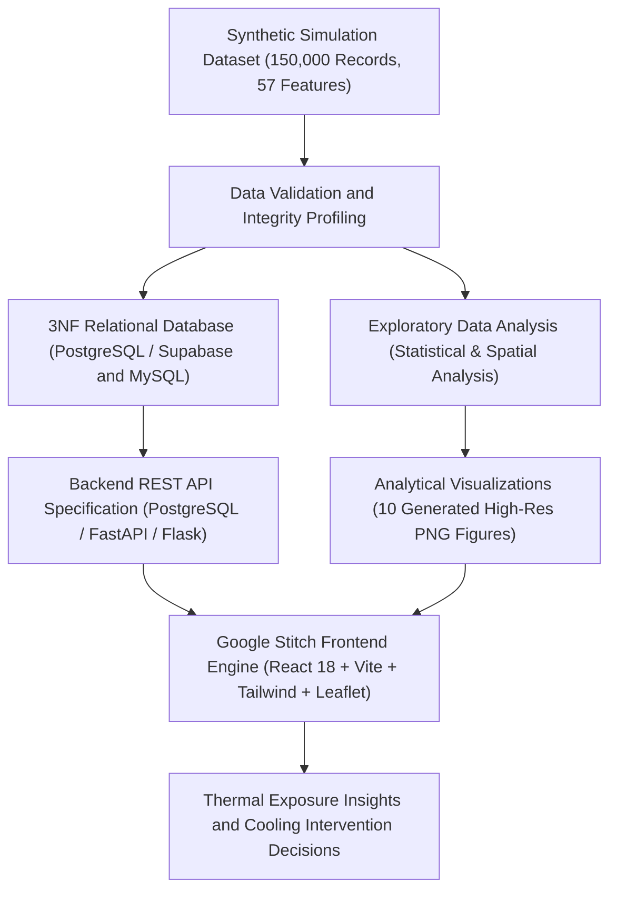

<p align="center">
  
  &nbsp;&nbsp;<b>Made For Indians — Made By Indians</b>&nbsp;&nbsp;
  
</p>

<p align="center">
  
</p>

<p align="center">
  
</p>

# HeatShield — Urban Heat Exposure Analysis and Cooling Intelligence Platform

[](#project-status-and-academic-context)
[](#team-name-members-and-work-distribution)
[](#database-design)
[](#dataset-and-data-integrity-disclosure)
[](#main-features)
[](#technology-stack)

---

## GitHub and Deployment Readiness

This repository is configured for professional GitHub collaboration and production-grade Vercel frontend deployment.

- **Frontend Core**: Repository root (`React 18 + Vite 5 + Tailwind CSS + Leaflet GIS + Recharts`).
- **Supabase Cloud Backend**: PostgreSQL database with Row Level Security (RLS) policies, authentication profiles, user settings, community heat readings, and the 150,000-record master observation repository.
- **Master Dataset Integration**: High-performance batch import pipelines (Node.js & Python) for the 150,000 observation Solapur microclimate dataset (`Heat Shield Master Dataset(2).csv`, 57 columns) with strict schema validation, idempotent upserting, and local dry-run modes.
- **Interactive Leaflet GIS**: Production-grade modular Leaflet and React-Leaflet mapping engine rendering 100 Solapur microclimate stations with dynamic temperature popups, heat risk classification, and India-wide reanalysis grid switching.
- **Google Stitch Architecture**: Fully integrates 7 comprehensive telemetry pages and the interactive submission module conforming to Google Stitch research design specifications.
- **Vercel Readiness**: Configured for instant single-page application (SPA) deployment with deep routing support via [`vercel.json`](vercel.json).
- **CI / Build Validation**: Production build validated cleanly via `npm run build` (`dist/` bundle tree-shaken, code-split into vendor chunks, and optimized).

---

## Team Name, Members, and Work Distribution

### Team Identifier: **TF-141**
**Institution**: MIT Vishwaprayag University (MIT-VPU), Solapur, Maharashtra, India  
**Course Track**: Semester III Integrated Project (FSD-1 + DBMS + EDADV)  
**Dedicated Team View**: Accessible directly inside the running application at [`/team`](src/pages/Team.jsx)

| Team Member | Student ID | Primary Academic Role | Key Deliverables & Responsibilities |
|---|---|---|---|
| **Furqan Bagwan** | `SCFU425004` | **Frontend Development (FSD-1)** | User interface architecture, Google Stitch component engineering, responsive page layouts, navigation paradigms, telemetry viewports, and visual presentation of heat findings. |
| **Aman Shaikh** | `SCFU425013` | **Exploratory Data Analysis & Visualization (EDADV)** | Dataset inspection, null-handling, statistical distributions, thermal correlation analysis, biophysical regressions (NDVI/NDBI vs. LST), and publication-ready charts. |
| **Bhavin Shankur** | `SCFU425014` | **Database Management & Backend (DBMS)** | 3NF relational schema design, PostgreSQL/Supabase and MySQL DDL migrations, spatial coordinate indexing, query optimization, and REST API architectural specifications. |

---

## Project Overview

HeatShield is an academic urban heat exposure analysis and cooling-intelligence platform developed for the **Solapur Urban Agglomeration, Maharashtra, India** (covering the simulation period 2021–2025). Built as an integrated Semester III capstone combining **Full Stack Development (FSD)**, **Database Management Systems (DBMS)**, and **Exploratory Data Analysis and Data Visualization (EDADV)**, HeatShield computationally organizes microclimate data, examines thermal exposure dynamics, and models cooling intervention priorities.

### The Problem HeatShield Addresses
Urban environments frequently experience pronounced spatial variations in temperature due to surface composition and human activity:
* **Thermal Disparities**: Densely built commercial and industrial sectors experience elevated land surface temperatures (LST) compared to vegetated areas.
* **Environmental Drivers**: Variations in vegetative density (NDVI), built-up surface intensity (NDBI), tree canopy coverage, surface albedo, and atmospheric radiation drive urban heat dynamics.
* **Decision Support**: Quantitative modeling of shade deficits, vegetative cover deficits, and exposure risks allows municipal planners to identify, evaluate, and prioritize potential cooling interventions.

> **Scope Clarification**: HeatShield is designed as a data-driven academic decision-support prototype. It is not an operational municipal emergency-alert system or a substitute for professional in-situ environmental monitoring.

---

## Table of Contents

- [Team Information](#team-name-members-and-work-distribution)
- [Project Overview](#project-overview)
- [Data Disclaimer](#dataset-and-data-integrity-disclosure)
- [Project Objectives](#project-objectives)
- [System Architecture](#architecture-overview)
- [Repository Structure](#repository-structure)
- [Main Features & Application Pages](#main-features--application-pages)
- [Database Design & Supabase Cloud Architecture](#database-design--supabase-cloud-architecture)
- [Master Dataset Integration & Ingestion Pipelines](#master-dataset-integration--ingestion-pipelines)
- [Data Visualizations](#data-visualizations)
- [Technology Stack](#technology-stack)
- [Setup and Running Instructions](#setup-and-running-instructions)
- [Project Status & Academic Context](#project-status-and-academic-context)
- [Credits & License](#credits-and-academic-use)

---

## Dataset and Data Integrity Disclosure

> [!WARNING]
> **Data Disclaimer:** HeatShield currently uses a **synthetic academic simulation dataset for Solapur covering 2021–2025** (150,000 observation records across 100 monitoring sites). Its values are computationally simulated for educational and research prototyping. They are **not** official Indian Meteorological Department (IMD) station observations, verified satellite measurements, municipal sensor readings, or validated public health records.

Please note the following analytical boundaries:
* **Illustrative Results**: All charts, statistical metrics, and dashboard values reflect the patterns synthesized within the simulation dataset.
* **Correlation vs. Causation**: Statistical associations (such as inverse correlations between vegetation indices and surface temperatures) describe model relationships and do not independently establish real-world causality.
* **Model-Derived Priorities**: Multi-Criteria Decision Making (MCDM) Cooling Priority Scores and estimated cooling potential values (°C) are algorithmic estimates, not guaranteed field outcomes.
* **Monitoring Sites**: Geospatial coordinates (17.6120°N–17.7220°N, 75.8360°E–75.9620°E) represent representative simulated microclimate stations across Solapur's 9 urban zones and must be independently verified prior to real-world deployment.

---

## Project Objectives

1. **Quantify Thermal Patterns**: Analyze ambient air temperature ($T_{air}$) and land surface temperature ($LST$) dynamics across diurnal and seasonal cycles.
2. **Examine Environmental Correlates**: Evaluate relationships between thermal metrics and biophysical indicators (NDVI, NDBI, NDWI, tree canopy cover %, impervious surface %, and solar radiation).
3. **Zone-Based Thermal Comparison**: Contrast heat exposure across 9 urban morphological zones in Solapur (Residential, Commercial, Industrial, Road Corridors, Parks, Educational, Transport, Waterbodies, and Open Land).
4. **Thermal Risk Classification**: Categorize locations into standardized public health heat-risk tiers (Low, Moderate, High, Very High) using multi-variable exposure logic.
5. **Mitigation Prioritization**: Identify high-priority candidate zones for targeted interventions (e.g., urban afforestation, reflective cool roofs, shaded pedestrian transit corridors) based on calculated Shade Gap and Cooling Priority Scores.
6. **Accessible Visual Communication**: Present findings through clear, publication-quality visualizations and an interactive web interface conforming to Google Stitch research guidelines.
7. **Demonstrate Academic Full-Stack Integration**: Integrate 3NF relational database models, rigorous statistical data science, and modern web engineering into an end-to-end curriculum project.

---

## Architecture Overview

The platform is designed around a structured data pipeline separating raw simulations, relational facts, statistical analysis, and interactive user interfaces:



---

## Repository Structure

```
TF-141-Heatshield/
├── README.md                                          # Root project documentation and architectural guide
├── index.html                                         # Single-page application entry point
├── package.json                                       # Project manifest, dependencies, and build scripts
├── postcss.config.js                                  # PostCSS configuration with Tailwind and Autoprefixer
├── tailwind.config.js                                 # Google Stitch color tokens, typography & spacing
├── vite.config.js                                     # Vite 5 bundler configuration with vendor chunk optimizer
├── vercel.json                                        # Vercel deployment rewrite rules for SPA routing
│
├── docs/                                              # Engineering specifications and workflows
│   └── MASTER_DATASET_IMPORT_GUIDE.md                 # 150k dataset import, validation & Supabase guide
│
├── scripts/                                           # Reusable ETL and data engineering scripts
│   ├── importMasterDataset.js                         # Node.js streaming batch CSV importer (upsert, dry-run)
│   ├── import_master_dataset.py                       # Python streaming batch CSV importer
│   └── generate_dashboard_data.py                     # Precomputes regional and monthly analytical summaries
│
├── supabase/                                          # Supabase database configuration & migrations
│   ├── config.toml                                    # Local Supabase CLI configuration
│   └── migrations/
│       ├── 20261020000001_heatshield_backend.sql      # Profiles, readings, user settings, RLS & triggers
│       └── 20261020000002_heatshield_master.sql       # Master 150k observation schema, indexes & public SELECT
│
├── Banner & Logo/                                     # Visual brand assets
│   ├── heatshield-icon.svg                            # Application vector icon
│   ├── heatshield-logo-primary.svg                    # Primary brand logo
│   ├── heatshield-github-banner.png                   # Repository header card
│   └── heatshield-website-banner.png                  # Dashboard web banner
│
├── Website Design Files/                              # Google Stitch design references & exports
│
├── src/                                               # React frontend application source code
│   ├── main.jsx                                       # React DOM root entry point
│   ├── App.jsx                                        # React Router v6 route configuration
│   ├── index.css                                      # Tailwind directives and custom scrollbar/Leaflet theme
│   │
│   ├── pages/                                         # Core application views (Google Stitch)
│   │   ├── Home.jsx                                   # Overview: Mission, quick metrics & telemetry
│   │   ├── Dashboard.jsx                              # Analytics: Recharts diurnal curves & zone breakdown
│   │   ├── IndiaHeatMap.jsx                           # Geographic: Leaflet interactive GIS microclimate map
│   │   ├── ExploreData.jsx                            # Explorer: 150k record tabular ledger with CSV export
│   │   ├── Methodology.jsx                            # Science: UHI formulation, parameters & BibTeX citation
│   │   ├── Team.jsx                                   # Contributors: TF-141 profiles, roles & stack
│   │   └── SubmitReading.jsx                          # Contribution: In-situ community reading submission
│   │
│   ├── components/
│   │   ├── layout/                                    # Navbar, Sidebar, PageLayout shell
│   │   ├── branding/                                  # IndianFlag, ProjectFooter with provenance notice
│   │   ├── common/                                    # ErrorBoundary, loading skeletons
│   │   └── map/                                       # Modular Leaflet GIS mapping components
│   │       ├── HeatShieldMap.jsx                      # Reusable Leaflet Map container with OSM tiles
│   │       ├── HeatMapMarkers.jsx                     # High-performance CircleMarker layers
│   │       ├── HeatMapPopup.jsx                       # Academic telemetry popup (Air Temp, LST, RH, Risk)
│   │       ├── HeatMapLegend.jsx                      # Thermal risk color ramps & threshold chips
│   │       ├── HeatMapControls.jsx                    # Domain switcher (Solapur / India), reset view
│   │       └── HeatMapIntensityLayer.jsx              # Semi-transparent thermal overlay
│   │
│   ├── services/                                      # Data access layer & API services
│   │   ├── masterDataService.js                       # 150k record querying, pagination & filter service
│   │   ├── heatmapService.js                          # GeoJSON telemetry and station microclimate service
│   │   └── supabaseClient.js                          # Supabase singleton client with env validation
│   │
│   └── data/                                          # Verified local datasets & offline fallbacks
│       ├── solapurLocations.js                        # 100 Solapur microclimate station coordinates & specs
│       ├── dashboardData.js                           # Precomputed monthly & zone aggregates from 150k rows
│       └── indiaGridData.js                           # India national thermal reanalysis grid
│
└── Datasets/                                          # Project data assets & analytical figures
    ├── datasets/                                      # Master simulation tables (150,000 rows × 57 cols)
    ├── database/                                      # PostgreSQL and MySQL 3NF relational schemas
    ├── charts/                                        # 10 publication-quality analytical figures (300 DPI)
    └── reports/                                       # Mathematical QA audits & validation reports
```

---

## Main Features & Application Pages

The HeatShield frontend implements a research-grade editorial design system adhering to the **Google Stitch** aesthetic:

### 1. Overview (`/`)
* **Core Academic Mission**: High-level problem statement and academic context for Solapur microclimate research.
* **Telemetry Metric Strip**: Key statistical aggregations (Average Air Temp $34.3^\circ\text{C}$, Peak LST $55.4^\circ\text{C}$, Active Simulation Stations $100$, Total Observation Records $150,000$).
* **Recent Readings**: Live simulation feeds showcasing localized monitoring node observations and temporal anomalies.

### 2. Analytics Dashboard (`/dashboard`)
* **Diurnal Thermal Progression**: Interactive Recharts time-series illustrating peak daytime surface heating ($55.4^\circ\text{C}$) vs. ambient air cooling.
* **Morphological Zone Contrast**: Comparative bar and box distributions contrasting high-stress industrial and transport corridors against low-stress vegetated zones.
* **Cooling Interventions & Aggregations**: 9-zone statistical summaries (NDVI, NDBI, Shade Deficit, Heat Risk) derived from the 150k master dataset, with one-click regional summary CSV export.

### 3. Geographic Heat Map (`/heat-map`)
* **Interactive Leaflet GIS**: Custom CartoDB-inspired tile styling with responsive pan/zoom over Solapur's urban footprint (`17.6599° N, 75.9064° E`).
* **Modular Map Architecture**: Built with [`src/components/map/HeatShieldMap.jsx`](src/components/map/HeatShieldMap.jsx), [`HeatMapMarkers.jsx`](src/components/map/HeatMapMarkers.jsx), [`HeatMapPopup.jsx`](src/components/map/HeatMapPopup.jsx), and [`HeatMapLegend.jsx`](src/components/map/HeatMapLegend.jsx).
* **100 Station Microclimate Nodes**: High-performance CircleMarker layers displaying all 100 Solapur monitoring sites with color-coded heat risk tiers.
* **Telemetry Inspector Popups**: Clickable popups revealing real-time thermodynamic metrics (Air Temp, LST, Relative Humidity, Wind Speed, Solar Radiation, NDVI, Shade Gap Index, and MCDM Cooling Priority Score).
* **Domain Switcher**: Seamlessly toggle between local Solapur Microclimate Stations (100 in-situ sites) and India-wide National Reanalysis Grid (54 national stations).
* **Semi-Transparent Intensity Overlay**: Visual heat stress envelope overlay with dynamic toggle controls.

### 4. Data Explorer (`/explore-data`)
* **150,000 Record Supabase Integration**: Real-time querying against the `public.heatshield_master` PostgreSQL cloud table via [`src/services/masterDataService.js`](src/services/masterDataService.js).
* **Server-Side Pagination & Page Sizing**: Smooth pagination controls supporting 10, 25, 50, and 100 records per page with total count indicators.
* **Multi-Parameter Filtering**: Interactive filters by Urban Zone (9 typologies), Heat Risk Tier (Low, Moderate, High, Very High), Search Query (station name, location ID, record ID), and Thermal Envelope Temperature Slider ($20^\circ\text{C}$–$55^\circ\text{C}$).
* **Active Record Inspector Drawer**: Slide-out telemetry drawer displaying all 57 biophysical attributes for any selected observation record.
* **Filter-Aware CSV Export**: Client-side streaming export of active filtered datasets directly to CSV.
* **Zero-Downtime Offline Fallback**: Automatically falls back to bundled 100-station microclimate fixtures when offline or prior to Supabase credentials configuration.

### 5. Methodology & Simulation Specifications (`/methodology`)
* **Mathematical Formulations**: Equations defining Land Surface Temperature (LST), Urban Heat Island (UHI) intensity, and Shade Gap Index.
* **Simulation Boundaries**: Explicit documentation of the calibrated WRF-Chem v4.3 / ERA5-Land model assumptions (2021–2025).
* **Academic Citation**: Pre-formatted BibTeX citation for scholarly attribution.

### 6. Team & Project Information (`/team`)
* **Team TF-141 Roster**: Complete profiles for Furqan Bagwan (`SCFU425004`), Aman Shaikh (`SCFU425013`), and Bhavin Shankur (`SCFU425014`).
* **Workstream Architecture**: Detailed breakdown of responsibilities across Frontend (FSD-1), Data Science (EDADV), and Database Engineering (DBMS).
* **System Pipeline**: Visual 5-stage workflow diagram tracking data from synthetic generation to cooling policy scores.
* **Academic Scope & Provenance Disclosure**: Prominent institutional transparency card for MIT Vishwaprayag University.

### 7. Submit In-Situ Reading (`/submit-reading`)
* **Community Data Contribution**: Structured input form allowing contributors to submit local temperature, humidity, and location readings.
* **Client-Side Validation**: Ensures thermodynamic bounds and coordinate boundaries are preserved before entry staging.

---

## Database Design & Supabase Cloud Architecture

The database architecture is organized across two distinct layers: a normalized **Third Normal Form (3NF)** relational specification for relational theory and benchmark evaluation, and an operational **Supabase PostgreSQL Cloud Repository** serving high-concurrency analytical and GIS telemetry to the frontend.

### 1. 3NF Relational Model (Academic Specification)

The 3NF schema eliminates data redundancy and guarantees analytical referential integrity across dimensional and fact entities:

| Entity Table | Classification | Primary Key | Foreign Keys | Row Count | Purpose |
|---|---|---|---|---|---|
| [`locations`](Datasets/database/heatshield_schema_postgres.sql#L72-L96) | Spatial Dimension | `location_id` | — | 100 | Static geographic monitoring site metadata, coordinates, elevation, population density, and zone type. |
| [`land_cover`](Datasets/database/heatshield_schema_postgres.sql#L104-L121) | Morphological Baseline | `location_id` | `location_id` $\rightarrow$ `locations` | 100 | Static biophysical site attributes (baseline vegetation %, impervious %, tree canopy %, albedo). |
| [`weather_observations`](Datasets/database/heatshield_schema_postgres.sql#L129-L157) | Meteorological Fact | `record_id` | `location_id` $\rightarrow$ `locations` | 150,000 | Time-series atmospheric observations (air temperature, humidity, wind, solar radiation, pressure). |
| [`surface_observations`](Datasets/database/heatshield_schema_postgres.sql#L165-L188) | Remote Sensing Fact | `record_id` | `record_id` $\rightarrow$ `weather_observations` | 150,000 | Remote sensing skin temperature (LST), spectral indices (NDVI, NDBI, NDWI), and shade availability. |
| [`heat_assessments`](Datasets/database/heatshield_schema_postgres.sql#L196-L213) | Thermal Risk Fact | `record_id` | `record_id` $\rightarrow$ `weather_observations` | 150,000 | Calculated UHI intensity, Heat Exposure Index, and public health risk categories. |
| [`interventions`](Datasets/database/heatshield_schema_postgres.sql#L221-L242) | Decision Fact | `record_id` | `record_id` $\rightarrow$ `weather_observations` | 150,000 | Shade Gap Index, Cooling Priority Score, recommended intervention, and estimated cooling potential. |

### 2. Operational Supabase Cloud Schema & Migrations

For real-time cloud data access, the platform deploys managed PostgreSQL tables in Supabase configured with **Row Level Security (RLS)**, compound performance indexes, and strict typing:

* **Migration 1: Core User & Community Telemetry** ([`supabase/migrations/20261020000001_heatshield_backend.sql`](supabase/migrations/20261020000001_heatshield_backend.sql))
  * `public.profiles`: User account extensions linked to `auth.users` with cascading triggers.
  * `public.heat_readings`: In-situ community temperature and microclimate submissions from `/submit-reading`.
  * `public.user_settings`: User theme, telemetry preferences, and regional notification tolerances.
* **Migration 2: Master Observation Repository** ([`supabase/migrations/20261020000002_heatshield_master.sql`](supabase/migrations/20261020000002_heatshield_master.sql))
  * `public.heatshield_master`: Consolidated 57-column observation table storing the complete 150,000-record Solapur dataset.
  * **Primary Key**: `record_id` (`BIGINT`) with unique constraint.
  * **Compound & Spatial Indexes**:
    * `idx_heatshield_master_loc_time` on `(location_id, observation_datetime DESC)`
    * `idx_heatshield_master_zone_risk` on `(zone_name, heat_risk_category)`
    * `idx_heatshield_master_air_temp` on `(air_temperature_c)`
    * `idx_heatshield_master_lst` on `(lst_celsius)`
    * `idx_heatshield_master_coords` on `(latitude, longitude)`
  * **Row Level Security (RLS) Policy**:
    * Public `SELECT` granted to `anon` and `authenticated` roles for read-only query access from the client frontend.
    * `INSERT`, `UPDATE`, and `DELETE` strictly restricted to `service_role` to secure the master repository against unauthorized client-side modification.

### 3. Schema Scripts Reference
* **PostgreSQL / Supabase 3NF DDL**: [`Datasets/database/heatshield_schema_postgres.sql`](Datasets/database/heatshield_schema_postgres.sql)
* **MySQL 8.0+ 3NF DDL**: [`Datasets/database/heatshield_schema_mysql.sql`](Datasets/database/heatshield_schema_mysql.sql)
* **Master Unified Reference**: [`Datasets/database/Heat Shield Database Schema.sql`](Datasets/database/Heat%20Shield%20Database%20Schema.sql)

---

## Master Dataset Integration & Ingestion Pipelines

HeatShield integrates the master microclimate simulation dataset into Supabase using high-performance, memory-efficient streaming batch ingestion tools.

### Dataset Profile: `Heat Shield Master Dataset(2).csv`
* **File Size**: $62.95\text{ MB}$ ($66,009,472\text{ bytes}$)
* **Total Rows**: $150,000$ observation records across $57$ biophysical attributes.
* **Data Integrity**: **0 missing or null values** across all columns; **0 duplicate** `record_id` entries.
* **Spatial Extent**: $100$ monitoring stations distributed across $9$ urban zones in Solapur, Maharashtra ($17.6120^\circ\text{N}$–$17.7220^\circ\text{N}$, $75.8360^\circ\text{E}$–$75.9620^\circ\text{E}$).
* **Temporal Span**: January 1, 2021 to December 31, 2025.

### Ingestion Tooling & Performance

Two production-grade batch importers are provided in [`scripts/`](scripts/):

1. **Node.js Streaming Batch Importer** ([`scripts/importMasterDataset.js`](scripts/importMasterDataset.js)):
   * Uses Node.js native streams and `csv-parse` for ultra-fast, low-memory streaming ingestion.
   * **Dry-Run Validation Throughput**: Parses and validates all $150,000$ rows in **$1.07$ seconds** (~$140,000$ rows/sec).
   * **Idempotent Upserting**: Uses `record_id` primary key upserting with configurable batch sizes (default: 500 rows/batch) and automatic network retry logic.
2. **Python Streaming Batch Importer** ([`scripts/import_master_dataset.py`](scripts/import_master_dataset.py)):
   * Standard library CSV streaming with explicit UTF-8 cross-platform console handling.
   * Mirrors all CLI arguments (`--dry-run`, `--limit`, `--batch-size`) for academic environments centered on Python data science.

### Ingestion CLI Commands

```bash
# Validate dataset integrity locally without uploading (Dry-Run Mode)
node scripts/importMasterDataset.js --dry-run

# Test upload with a small batch limit (e.g., first 100 rows)
node scripts/importMasterDataset.js --limit 100 --batch-size 50

# Execute full 150,000-record batch ingestion
node scripts/importMasterDataset.js --batch-size 500
```

> [!IMPORTANT]
> **Security & Key Management:**
> - The frontend application utilizes `VITE_SUPABASE_URL` and `VITE_SUPABASE_PUBLISHABLE_KEY` (public anon key), allowing read-only `SELECT` queries on `heatshield_master`.
> - Ingestion scripts require write privileges via `SUPABASE_SERVICE_ROLE_KEY` passed through local `.env` or process environment.
> - **The `SUPABASE_SERVICE_ROLE_KEY` and large CSV files are strictly excluded from frontend code, Vite bundles, and Git tracking via `.gitignore`.**
>
> For full schema mapping, troubleshooting, and indexing guidelines, refer to the [Master Dataset Import Guide](docs/MASTER_DATASET_IMPORT_GUIDE.md).

---

## Data Visualizations

The project contains 10 presentation-grade analytical figures rendered at high resolution (300 DPI, up to 4200 px wide) located in [`Datasets/charts/`](Datasets/charts/):

| Figure | Chart File | Core Analytical Finding |
|---|---|---|
| **01** | [`01_temperature_distribution.png`](Datasets/charts/01_temperature_distribution.png) | Bimodal distribution contrasting ambient air temperature ($\mu = 34.28^\circ\text{C}$) vs. land surface temperature ($\mu = 35.89^\circ\text{C}$, max $55.35^\circ\text{C}$). |
| **02** | [`02_monthly_seasonal_trends.png`](Datasets/charts/02_monthly_seasonal_trends.png) | Annual thermal trajectory showing severe pre-monsoon heat peaks (April–May) and seasonal drops during July–August. |
| **03** | [`03_correlation_heatmap.png`](Datasets/charts/03_correlation_heatmap.png) | Pearson correlation matrix highlighting the negative cooling effect of NDVI ($r = -0.31$) and heating effect of NDBI ($r = +0.37$). |
| **04** | [`04_ndvi_vs_lst_scatter.png`](Datasets/charts/04_ndvi_vs_lst_scatter.png) | Hexbin/scatter distribution showing surface temperature moderation as vegetative density increases. |
| **05** | [`05_builtup_intensity_vs_lst.png`](Datasets/charts/05_builtup_intensity_vs_lst.png) | Scatter analysis showing higher built-up density indices driving surface heat concentrations. |
| **06** | [`06_heat_risk_distribution.png`](Datasets/charts/06_heat_risk_distribution.png) | Categorical breakdown demonstrating that High and Very High thermal risk tiers concentrate in Industrial and Commercial corridors. |
| **07** | [`07_geographic_hotspot_map.png`](Datasets/charts/07_geographic_hotspot_map.png) | Spatial map of Solapur coordinates color-coded by mean LST and sized by MCDM cooling priority score. |
| **08** | [`08_cooling_priority_ranking.png`](Datasets/charts/08_cooling_priority_ranking.png) | Ranked horizontal prioritization of the top 25 urban sites requiring municipal cooling intervention. |
| **09** | [`09_location_zone_comparison.png`](Datasets/charts/09_location_zone_comparison.png) | Multi-attribute box plots comparing LST, shade deficits, and UHI intensity across all 9 urban zones. |
| **10** | [`10_executive_summary_dashboard.png`](Datasets/charts/10_executive_summary_dashboard.png) | Comprehensive multi-panel executive dashboard consolidating key findings, distributions, and policy metrics. |

---

## Technology Stack

The HeatShield platform is structured around verified and active technologies across data engineering, database management, and application development:

* **Frontend Web Application**:
  * **React 18** — Declarative component-based UI architecture.
  * **Vite 5** — High-performance frontend build tool with Esbuild pre-bundling and vendor chunk splitting.
  * **JavaScript (ES6+)** — Client-side interaction logic.
  * **Tailwind CSS v3** — Curated design tokens, responsive utilities, and clean planar cards conforming to Google Stitch.
  * **Leaflet & React-Leaflet** — Interactive 2D geospatial GIS mapping engine with custom tiles and circle markers.
  * **Recharts** — Responsive charting for diurnal and statistical distributions.
  * **Supabase Client SDK (`@supabase/supabase-js`)** — High-performance cloud PostgreSQL querying with pagination and RLS.
  * **Lucide React** — Modern UI iconography.
* **Data Engineering & Ingestion Pipelines**:
  * **Node.js Streaming Pipeline (`csv-parse`)** — High-throughput batch streaming ingestion ($140,000$+ rows/sec validation).
  * **Python (Pandas, NumPy)** — Dataset synthesis, cleaning, validation checks, and feature derivation.
  * **Matplotlib & Seaborn** — Generation of 10 publication-quality analytical figures.
  * **OpenPyXL / Microsoft Excel** — Tabular data dictionary and schema documentation.
* **Database & Cloud Storage**:
  * **PostgreSQL 14+ / Supabase Cloud** — Production cloud relational database using strict relational constraints, spatial indexes, and Row Level Security.
  * **MySQL 8.0+** — Secondary relational database alternative for standard academic RDBMS environments.
  * **Structured Query Language (SQL)** — 3NF DDL migrations, composite indexing, and 12 analytical query benchmarks.
* **Version Control & Deployment**:
  * **Git & GitHub** — Collaborative source code and document version control.
  * **Vercel** — Production static hosting with single-page application rewrites via `vercel.json`.

---

## Setup and Running Instructions

### 1. Prerequisites
* **Node.js 18+** and `npm` installed.
* **Python 3.9+** (optional, for Python batch ingestion and analytical figures).
* **Supabase Account** (for cloud database) **OR** local **PostgreSQL 14+ / MySQL 8.0+**.

---

### 2. Environment Configuration (`.env`)

Create a local environment file in the repository root by copying the template:

```bash
# Copy template file
cp .env.example .env
```

Configure your credentials in `.env`:

```env
# Public Supabase credentials (safe for client-side frontend)
VITE_SUPABASE_URL=https://your-project-id.supabase.co
VITE_SUPABASE_PUBLISHABLE_KEY=your-anon-key-here

# Secret Service Role Key (used ONLY for CLI batch data ingestion scripts)
# DO NOT expose or commit this key to Git
SUPABASE_SERVICE_ROLE_KEY=your-service-role-key-here
```

> [!NOTE]
> **Zero-Configuration Fallback:** If Supabase environment variables are omitted or invalid, HeatShield automatically enters **Offline Resilient Mode**, serving bundled station telemetry from [`src/data/solapurLocations.js`](src/data/solapurLocations.js) and [`src/data/dashboardData.js`](src/data/dashboardData.js) without crashing.

---

### 3. Frontend Application Execution (React + Vite)

#### Standard Local Development:
```bash
# 1. Install dependencies
npm install

# 2. Launch Vite development server
npm run dev
```
The application will launch and be accessible at **`http://localhost:3000/`**.

#### Production Build & Verification:
```bash
# Compile and optimize production bundle
npm run build

# Preview production build locally
npm run preview
```

---

### 4. Supabase Database Deployment & Migrations

Deploy the database schemas to your Supabase project using either the **Supabase Dashboard SQL Editor** or the **Supabase CLI**:

1. **Migration 1 (Profiles, Community Readings, Settings):**  
   Execute [`supabase/migrations/20261020000001_heatshield_backend.sql`](supabase/migrations/20261020000001_heatshield_backend.sql).
2. **Migration 2 (Master 150k Table, Indexes & RLS):**  
   Execute [`supabase/migrations/20261020000002_heatshield_master.sql`](supabase/migrations/20261020000002_heatshield_master.sql).

---

### 5. Master Dataset Batch Ingestion

Once Migration 2 is executed, ingest the 150,000-record CSV into Supabase using either the Node.js or Python batch importer:

#### Node.js Importer (Recommended — High Throughput):
```bash
# 1. Perform a dry-run local validation (0 network calls, validates 150k rows in ~1s)
node scripts/importMasterDataset.js --dry-run

# 2. Test upload with a small limit
node scripts/importMasterDataset.js --limit 100 --batch-size 50

# 3. Ingest the entire 150,000-record dataset
node scripts/importMasterDataset.js --batch-size 500
```

#### Python Importer (Alternative):
```bash
# 1. Dry run
python scripts/import_master_dataset.py --dry-run

# 2. Full ingestion
python scripts/import_master_dataset.py --batch-size 500
```

*For troubleshooting and detailed schema type mappings, see [`docs/MASTER_DATASET_IMPORT_GUIDE.md`](docs/MASTER_DATASET_IMPORT_GUIDE.md).*

---

### 6. Alternative Relational Deployments (3NF Academic Spec)

#### Option A: Local PostgreSQL 14+
```bash
psql -U postgres -d heatshield_db -f "Datasets/database/heatshield_schema_postgres.sql"
```

#### Option B: MySQL 8.0+
```sql
CREATE DATABASE heatshield_db CHARACTER SET utf8mb4 COLLATE utf8mb4_unicode_ci;
USE heatshield_db;
SOURCE Datasets/database/heatshield_schema_mysql.sql;
```

---

### 7. Vercel Deployment Checklist

The frontend is ready for zero-configuration deployment to Vercel:

1. Import your GitHub repository (`TF-141-Heatshield`) into Vercel.
2. Select **Vite** as the Framework Preset.
3. Configure Environment Variables in Vercel Project Settings:
   - `VITE_SUPABASE_URL`
   - `VITE_SUPABASE_PUBLISHABLE_KEY`
4. Root Directory: `./` (repository root).
5. Build Command: `npm run build`
6. Output Directory: `dist`
7. Deploy. The included [`vercel.json`](vercel.json) automatically routes direct visits (e.g. `/team`, `/dashboard`, `/heat-map`, `/explore-data`) to `index.html` without 404 errors.

---

## Project Status and Academic Context

* **Program**: B.Tech Semester III (Combined Academic Project)
* **Institution**: MIT Vishwaprayag University (MIT-VPU), Solapur
* **Course Modules**:
  * Full Stack Development (FSD-1)
  * Database Management Systems (DBMS)
  * Exploratory Data Analysis & Data Visualization (EDADV)
* **Current Status**:
  * ✅ Master synthetic simulation dataset (150,000 rows × 57 cols) generated and audited.
  * ✅ 12-section mathematical and physical QA validation passed.
  * ✅ Complete 3NF relational schemas implemented for PostgreSQL and MySQL.
  * ✅ Supabase cloud migrations deployed with Row Level Security (RLS) policies and compound performance indexes.
  * ✅ High-throughput streaming batch importers (Node.js & Python) created with dry-run validation.
  * ✅ Interactive Leaflet GIS mapping engine deployed with 100 Solapur stations, microclimate telemetry popups, and layer toggles.
  * ✅ Data Explorer implemented with server-side pagination, thermal envelope filters, record drawer, and CSV exporter.
  * ✅ Analytics Dashboard implemented with diurnal progression curves and 9-zone aggregations.
  * ✅ 10 publication-quality analytical visualization figures created.
  * ✅ Production build verified (`npm run build` exit code `0` with optimized vendor chunking).
  * 🟡 Python Flask REST API backend specifications staged for subsequent milestone.

---

## Credits and Academic Use

HeatShield is an academic project developed by **Team TF-141**:
* **Furqan Bagwan** (`SCFU425004`) — Frontend Development (FSD-1)
* **Aman Shaikh** (`SCFU425013`) — Exploratory Data Analysis & Data Visualization (EDADV)
* **Bhavin Shankur** (`SCFU425014`) — Database Management & Backend (DBMS)

Developed for academic demonstration and research prototyping at **MIT Vishwaprayag University (MIT-VPU)**, Solapur, Maharashtra, India.

### License
Academic Open Science Prototype. Created for educational and research evaluation under the MIT Vishwaprayag University curriculum.
