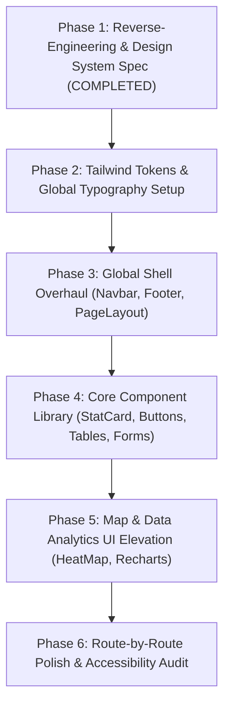

# Reverse-Engineered Design System: Apple Web Design System & HeatShield Adaptation Framework

> **Document Type:** UI/UX & Frontend Architecture Specification  
> **Target Path:** `docs/design-research/apple-inspired-design-system.md`  
> **Date of Inspection:** October 27, 2026  
> **Author:** Antigravity Senior UI/UX & Frontend Design System Analyst  
> **Research Methodology:** Dynamic headless browser reverse-engineering (Playwright runtime), live DOM extraction, computed CSS evaluation (`window.getComputedStyle`), stylesheet ruleset parsing, and multi-viewport responsive testing across Desktop (1920×1080), Tablet (834×1194), and Mobile (390×844).

---

## 1. Executive Summary

Apple's web interface is universally recognized as the benchmark of digital product elegance and brand prestige. Across millions of daily visitors, it creates a visceral impression of calm luxury, technical mastery, and frictionless usability.

Through rigorous live browser reverse-engineering of Apple’s official web ecosystem (`apple.com`, `/iphone/`, `/mac/`, and `/ipad/`), this research deconstructs the foundational engineering and design principles that produce this result:

1. **Optical Typographic Discipline:** Apple employs an optical duality between **SF Pro Display** (for text $\ge 20\text{px}$, characterized by tight tracking and compact vertical metrics) and **SF Pro Text** (for text $< 20\text{px}$, engineered with tall x-height, wide apertures, and generous tracking). Headlines are concise, bold, and declarative; body copy is strictly bounded to prevent eye fatigue.
2. **Extreme Chromatic Restraint:** Apple does not decorate with color. The interface is almost entirely monochrome (`#ffffff`, `#fafafc`, `#f5f5f7`, `#1d1d1f`, `#86868b`). Chromatic accents are strictly functional: action blue (`#0071e3`) for interactive controls, system amber/red only for alerts.
3. **Generous Vertical Breathing Room:** Sections breathe with an expansive **`120px` vertical rhythm** on desktop (scaling to `56px` on mobile). Content is never cramped; each product or concept is allowed to command the entire viewport.
4. **Subtle Tactile Surfaces & Frosted Translucency:** Apple avoids harsh, heavy box shadows. Depth is achieved through multi-layered translucent glassmorphism (`backdrop-filter: saturate(1.8) blur(20px)`), ultra-thin `1px` translucent borders (`rgba(0, 0, 0, 0.08)`), and generous rounded radii (`28px` on cards, `980px` on pill buttons).
5. **Purposeful Restrained Motion:** Motion is physics-based (`cubic-bezier(0.25, 0.1, 0.25, 1)`), snappy ($150\text{ms}$–$300\text{ms}$), and never gratuitous. It respects `@media (prefers-reduced-motion: reduce)` across every interactive component.

### The HeatShield Translation Mandate
**HeatShield** is an academic platform focused on urban heat exposure analysis and cooling intelligence for Solapur, Maharashtra. It is not an e-commerce catalog; it is an academic, data-dense scientific platform.

Adapting Apple’s design philosophy to HeatShield does not mean copying consumer hardware marketing or Apple logos. It means adopting Apple’s **structural rigor, typography hierarchy, negative space, and refined card surfaces**, and marrying them with **high-density analytical dashboards, scientific data tables, and an authoritative thermal color ramp** (Teal $\rightarrow$ Amber $\rightarrow$ Orange $\rightarrow$ Crimson).

---

## 2. Research Methodology & Pages Inspected

### 2.1 URLs Inspected
- **Primary Global Gateway:** [`https://www.apple.com/`](https://www.apple.com/) (Inspected for global navigation, root design tokens, hero billboard units, and base font rendering).
- **Product Architecture Reference:** [`https://www.apple.com/iphone/`](https://www.apple.com/iphone/) (Inspected for chapter navigation, product comparison cards, interactive media galleries, and alternating background sections).
- **Desktop Showcase Reference:** [`https://www.apple.com/mac/`](https://www.apple.com/mac/) (Inspected for tech-spec callouts, large data metric typography, hardware comparison grids, and section vertical rhythm).
- **Editorial & Visual Storytelling Reference:** [`https://www.apple.com/ipad/`](https://www.apple.com/ipad/) (Inspected for oversized editorial headlines, modal sheets, card triggers, and responsive breakpoint transitions).

### 2.2 Inspection Protocol
- **Runtime:** Playwright MCP automated browser runtime with direct JavaScript evaluation.
- **Viewports Tested:**
  - Desktop: `1920 × 1080` and `1440 × 900`
  - Tablet: `834 × 1194` (iPad Air / Pro portrait)
  - Mobile: `390 × 844` (iPhone 14 / modern smartphone standard)
- **Data Extracted:**
  - Actual computed styles via `window.getComputedStyle()`.
  - Declared CSS Custom Properties (`:root` variables prefixed with `--sk-` and `--r-`).
  - Active `@font-face` declarations and font stacks.
  - Media queries and responsive breakpoint rules.
  - Hover states, active pseudo-classes, and focus-visible rings.
  - Layout bounding rects, padding scales, and container max-widths.

### 2.3 Browser Inspection Limitations
1. **Proprietary Font Binary Protection:** Apple serves `.woff2` font files from private CDN endpoints with strict CORS policies. The font definitions and computed metrics are fully visible, but the raw font files are proprietary property of Apple Inc.
2. **Dynamic Client Localization:** Based on GeoIP, Apple injects an auxiliary location banner (`.ac-ls-banner`), adjusting the root viewport top offset dynamically.
3. **Encrypted Video / Canvas Layers:** Interactive 3D and scrubbable scroll canvas sequences use internal WebGL shaders whose exact vertex shaders cannot be extracted via standard DOM CSS inspection.

---

## 3. Typography Analysis

Apple's typography is the single most critical factor in its brand identity. It communicates clarity, premium craftsmanship, and authority without decorative embellishments.

### 3.1 Primary Typeface & Font Stacks
Computed inspection reveals the exact font-family declarations used across Apple's digital ecosystem:

*Directly Observed Declarations:*
- **Body & Small UI (< 20px):**
  ```css
  font-family: "SF Pro Text", "SF Pro Icons", "Helvetica Neue", Helvetica, Arial, sans-serif;
  ```
- **Headlines & Large Display (≥ 20px):**
  ```css
  font-family: "SF Pro Display", "SF Pro Icons", "Helvetica Neue", Helvetica, Arial, sans-serif;
  ```
- **Fallback / System Stack:**
  ```css
  font-family: "SF Pro Text", "Myriad Set Pro", system-ui, -apple-system, BlinkMacSystemFont, "Segoe UI", "SF Pro Icons", "Apple Legacy Icons", "Helvetica Neue", Helvetica, Arial, sans-serif;
  ```

### 3.2 The SF Pro Optical Size Distinction
Apple splits its San Francisco typeface into two distinct optical variants:
1. **SF Pro Display (≥ 20px):**
   - Letterforms have tighter tracking (`letter-spacing: -0.096px` to `-0.576px` at 48px–64px).
   - Slightly more delicate stroke contrasts and closed apertures.
   - Line height is compressed to $1.05$–$1.15\times$ font size, preventing headings from looking disjointed.
2. **SF Pro Text (< 20px):**
   - Letterforms feature taller x-heights and wider internal counters.
   - Letter spacing is looser (`letter-spacing: -0.224px` to `-0.374px` at 14px–17px).
   - Line height is expanded to $1.45$–$1.55\times$ font size ($25\text{px}$ on $17\text{px}$ body) for effortless reading.

### 3.3 Text Smoothing and Rendering
Across all inspected pages, Apple enforces hardware antialiasing at the root level:
```css
-webkit-font-smoothing: antialiased;
-moz-osx-font-smoothing: grayscale;
text-rendering: optimizeLegibility;
```
This prevents thick font weight blooming on macOS and Windows, maintaining razor-sharp rendering.

### 3.4 Headline to Supporting Copy Balance
Observed across the iPad and iPhone pages:
- **Headline:** 1 to 4 words maximum (e.g., *"Pro further."*, *"Explore the lineup."*, *"iPad"*).
- **Subhead:** Exactly 1 brief, rhythmic sentence (e.g., *"More than a little awesome."*, *"Designed for life at home."*).
- **Body:** Bounded to a maximum width of `430px` to `680px`, ensuring line lengths never exceed 65–75 characters per line.

---

## 4. Legally Usable Font Stacks for Third-Party Websites

> [!CAUTION]
> **Legal Compliance Warning:**
> Apple's San Francisco (`SF Pro`, `SF Pro Display`, `SF Compact`, `New York`) font files are proprietary software protected under Apple's Software License Agreements. They are licensed solely for Apple operating systems and developers creating applications for Apple platforms. Downloading, embedding, or redistributing Apple's `.woff2` files on a public third-party web server violates copyright law.

### 4.1 Recommended Solution: The "Native-First + Open-Source Parity" Stack

To achieve an authentic Apple-grade visual feel 100% legitimately across all operating systems:

#### Option A: Native System Font Stack (Zero Network Overhead)
Invokes SF Pro natively on Apple devices (macOS, iOS, iPadOS), Segoe UI on Windows, and Roboto on Android:
```css
font-family: -apple-system, BlinkMacSystemFont, "Segoe UI", Roboto, Helvetica, Arial, sans-serif, "Apple Color Emoji", "Segoe UI Emoji";
```

#### Option B: The "Inter" Variable Font Stack (Recommended for HeatShield)
**Inter** (created by Rasmus Andersson) is universally considered the gold standard open-source counterpart to SF Pro. It was specifically designed for high-density computer screens and features:
- Optical sizing (`opsz` variable axis from 14pt to 32pt).
- Tabular figures (`tnum` OpenType feature) — **crucial for scientific temperature and coordinate data tables in HeatShield**.
- Calibrated x-height and letter-spacing matching SF Pro.

```css
/* HeatShield Primary Typography Stack */
--font-sans: 'Inter', -apple-system, BlinkMacSystemFont, "Segoe UI", Roboto, sans-serif;
--font-mono: 'JetBrains Mono', 'SF Mono', Menlo, Consolas, Monaco, monospace;
```

#### Option C: Font Features Configuration for Scientific Precision
```css
.font-scientific {
  font-family: var(--font-sans);
  font-feature-settings: "cv02", "cv03", "cv04", "cv11", "tnum";
}
```
*Note: `tnum` ensures that numerical readings (e.g., `42.3°C` vs `41.1°C`) share identical character widths, preventing jittering numbers in live data dashboards.*

---

## 5. Typography Scale: Desktop vs. Mobile

The table below compiles **directly observed Apple metrics** alongside the **tailored recommendations for HeatShield**.

| Typographic Level | Apple Desktop (Observed) | Apple Mobile (Observed) | HeatShield Recommendation | Weight | Line Height | Letter Spacing | HeatShield Usage Context |
| :--- | :--- | :--- | :--- | :--- | :--- | :--- | :--- |
| **Billboard Hero** | `64px`–`80px` | `40px`–`48px` | `56px` (Desktop) / `36px` (Mobile) | `600` | `1.08` | `-0.02em` | Homepage Hero, Solapur Heat Exposure Banner |
| **Section Title (H2)** | `40px`–`48px` | `28px`–`32px` | `36px` (Desktop) / `28px` (Mobile) | `600` | `1.15` | `-0.015em` | Dashboard & Explore Section Headers |
| **Card / Widget Title (H3)** | `28px`–`32px` | `22px`–`24px` | `24px` (Desktop) / `20px` (Mobile) | `600` | `1.2` | `-0.01em` | StatCard Titles, Ward Ranking Cards |
| **Subhead / Editorial** | `24px` | `19px` | `20px` (Desktop) / `17px` (Mobile) | `400` | `1.4` | `+0.005em` | Descriptive Subtitles beneath Headings |
| **Base Body Text** | `17px` *(Observed)* | `17px` *(Observed)* | `16px`–`17px` | `400` | `1.5` (`25px`) | `-0.011em` | Methodology documentation, narrative copy |
| **Small UI / Secondary** | `14px` | `14px` | `14px` | `400` / `500` | `1.42` | `-0.006em` | Data Table Cells, Secondary Stat Labels |
| **Eyebrow / Category Tag** | `12px` | `12px` | `12px` | `600` | `1.33` | `+0.04em` | Uppercase Module Tags (`SOLAPUR SENSOR NETWORK`) |
| **Footnote / Meta** | `12px` | `11px`–`12px` | `12px` | `400` | `1.33` | `0` | Timestamp, Data Source Attribution (`Landsat-8 / MODIS`) |
| **Data Metric Readout** | `48px`–`56px` | `36px`–`40px` | `44px` (Desktop) / `32px` (Mobile) | `600` (Monospace/tnum) | `1.0` | `-0.02em` | Live Temperature (`43.8°C`), Heat Index, UHI $\Delta T$ |

---

## 6. Font Weight & Line-Height Recommendations

### 6.1 Weight Allocation Rules
Direct CSS ruleset inspection revealed Apple's strict weight restraint:
- **`400` (Regular):** Used for **90% of all text** (body copy, subheads, secondary captions, standard navigation links, and primary pill button labels).
- **`500` (Medium):** Used sparingly for interactive link hover states and active tab indicators.
- **`600` (Semibold):** Used for **all structural titles**, section headlines, stat card headers, and button emphasis.
- **`700` (Bold):** Almost never used on Apple's modern web pages! Apple relies on size (`48px`–`64px`) and contrast rather than heavy weight (`700`–`900`), which prevents the interface from feeling aggressive or cluttered.

### 6.2 Line-Height Proportions
- **Headlines ($\ge 32\text{px}$):** Tight proportional ratio between **$1.05$ and $1.15$**. Headings must form a unified visual block.
- **Subheads ($20\text{px}$–$24\text{px}$):** Moderate ratio between **$1.3$ and $1.4$**.
- **Body Copy ($16\text{px}$–$17\text{px}$):** Generous ratio between **$1.47$ and $1.55$** (directly observed: `17px` font size with `25px` line height).
- **Captions & Meta ($12\text{px}$):** Compact ratio of **$1.33$** (`16px` line height).

---

## 7. Spacing Scale

### 7.1 Observed Apple Rhythm Tokens
From Apple's `:root` stylesheet:
- `--sk-default-stacked-margin: 0.4em;` (Gap between closely related typographic pairs)
- `--sk-paragraph-plus-element-margin: 0.8em;` (Gap between paragraph and following element)
- `--sk-headline-plus-headline-margin: 0.4em;` (Gap between eyebrow and headline)
- `--sk-paragraph-plus-headline-margin: 1.6em;` (Gap between body copy and new heading block)
- Section Padding Desktop: **`120px 0px`** *(Directly observed)*
- Section Padding Mobile: **`56px 0px`** *(Directly observed)*

### 7.2 HeatShield System Spacing Scale (8pt Grid)

| Token | Pixels | Rem Equivalent | HeatShield Semantic Usage |
| :--- | :--- | :--- | :--- |
| `spacing-1` | `4px` | `0.25rem` | Badge padding, micro icon gaps |
| `spacing-2` | `8px` | `0.5rem` | Inline icon-to-label spacing, compact button py |
| `spacing-3` | `12px` | `0.75rem` | Input field vertical padding, tag margins |
| `spacing-4` | `16px` | `1.0rem` | Standard card internal padding, table cell py |
| `spacing-5` | `20px` | `1.25rem` | Modal element spacing, button px (`11px 21px`) |
| `spacing-6` | `24px` | `1.5rem` | Primary card padding, grid gutter |
| `spacing-8` | `32px` | `2.0rem` | Dashboard widget separation, mobile section gap |
| `spacing-12` | `48px` | `3.0rem` | Tablet section separation |
| `spacing-16` | `64px` | `4.0rem` | Sub-section vertical rhythm |
| `spacing-20` | `80px` | `5.0rem` | Compact desktop section rhythm |
| `spacing-30` | `120px` | `7.5rem` | **Apple-grade full editorial section padding** |

---

## 8. Layout & Container-Width Recommendations

### 8.1 Observed Apple Container Boundaries
- Global Nav Max Width: `1024px` *(Directly observed: `.globalnav-content { max-width: 1024px; }`)*
- Editorial Copy Max Width: `430px`–`680px` *(Directly observed: `.ac-ls-copy { max-width: 430px; }`)*
- Product Grid Max Width: `1024px` to `1200px`
- Full Bleed Section: `100vw` with internal safety margins (`padding: 0 24px` on mobile, `padding: 0 40px` on desktop)

### 8.2 HeatShield Layout Blueprint
HeatShield requires three distinct container widths to balance editorial storytelling with analytical data density:

1. **`container-editorial` (`max-width: 768px`):** Used for Methodology documentation, Research Papers, and Project Background narrative.
2. **`container-standard` (`max-width: 1024px`):** Used for Authentication, User Profile, Reading Submission form, and Team pages.
3. **`container-dashboard` (`max-width: 1440px`):** Used for the Interactive Solapur HeatMap, Spatial Exploration Grid, and Multi-Chart Analytical Views.

```css
/* Layout Primitives */
.layout-container-dashboard {
  width: 100%;
  max-width: 1440px;
  margin-left: auto;
  margin-right: auto;
  padding-left: clamp(16px, 4vw, 40px);
  padding-right: clamp(16px, 4vw, 40px);
}
```

---

## 9. Color Palette: Observed Apple Values vs. HeatShield Adaptation

### 9.1 Directly Observed Apple System Colors

| Token Name | Observed CSS Value | Computed HEX | Role in Apple Design System |
| :--- | :--- | :--- | :--- |
| `--sk-body-background-color` | `rgb(255, 255, 255)` | `#ffffff` | Primary page canvas |
| `--sk-fill-secondary` | `rgb(250, 250, 252)` | `#fafafc` | Flyout menus, search backgrounds |
| `--sk-fill-tertiary` | `rgb(245, 245, 247)` | `#f5f5f7` | Alternating section fills, card backgrounds |
| `--sk-body-text-color` | `rgb(29, 29, 31)` | `#1d1d1f` | Primary high-contrast body & heading text |
| `--sk-glyph-gray-secondary` | `rgb(110, 110, 115)` | `#6e6e73` | Secondary text, sub-labels, icons |
| `--sk-glyph-gray-tertiary` | `rgb(134, 134, 139)` | `#86868b` | Tertiary text, meta captions, disabled states |
| `--sk-focus-color` | `#0071e3` | `#0071e3` | Action blue, button fill, focus-visible outline |
| `--sk-button-background-hover` | `#0076df` | `#0076df` | Interactive button hover fill |
| `--sk-body-link-color` | `rgb(0, 102, 204)` | `#0066cc` | Hyperlink color on light canvas |
| `--r-globalnav-bg` | `rgba(255, 255, 255, 0.8)` | — | Translucent navigation bar glass |
| Dark Section Canvas | `rgb(22, 22, 23)` | `#161617` | Apple Pro dark section backgrounds |
| Dark Section Heading | `rgb(245, 245, 247)` | `#f5f5f7` | High contrast white text on dark canvas |
| Dark Mode Link / Accent | `rgb(41, 151, 255)` | `#2997ff` | High luminance blue for dark backgrounds |

### 9.2 The HeatShield Color Adaptation Strategy
HeatShield preserves Apple's neutral palette (`#ffffff`, `#fafafc`, `#f5f5f7`, `#1d1d1f`, `#86868b`) for UI surfaces, typography, borders, and navigation.

Instead of consumer hardware marketing blue, HeatShield adopts **scientifically calibrated thermal spectrum tokens**:

```
Thermal Risk Scale (Scientifically Harmonized):
┌──────────────┬──────────────┬──────────────┬──────────────┐
│  Normal/Safe │   Moderate   │  High Risk   │   Critical   │
│  #059669     │   #d97706    │  #ea580c     │   #dc2626    │
│  Teal        │   Amber      │  Orange      │   Crimson    │
│  (< 34°C)    │  (34–38°C)   │  (38–42°C)   │   (> 42°C)   │
└──────────────┴──────────────┴──────────────┴──────────────┘
```

- **Brand Action Primary:** `#2563eb` (Solapur Academic Indigo — Apple-grade crisp blue)
- **Safe / Cooling Zone:** `#059669` (Thermal Resilient Green / High NDVI vegetation)
- **Moderate Exposure:** `#d97706` (Solar Amber / Mid-range thermal stress)
- **Severe Exposure:** `#ea580c` (Heat Wave Orange / Built-up high LST)
- **Critical Emergency:** `#dc2626` (Thermal Danger Crimson / Extreme urban heat island)

---

## 10. Button and Navigation Specifications

### 10.1 Global Navigation (`#globalnav`)
*Directly Observed from Computed CSS:*
- **Height:** `44px` (Desktop) / `48px` (Mobile)
- **Positioning:** `position: fixed; top: 0; left: 0; width: 100%; z-index: 9999;`
- **Surface Material:** `background-color: rgba(255, 255, 255, 0.8);`
- **Backdrop Filter:** `saturate(1.8) blur(20px);` (Webkit: `-webkit-backdrop-filter: saturate(1.8) blur(20px);`)
- **Border:** `border-bottom: 1px solid rgba(0, 0, 0, 0.08);` (Fades in dynamically on scroll)
- **Typography:** `font-size: 12px; font-weight: 400; color: rgba(0, 0, 0, 0.8); letter-spacing: -0.01em;`
- **Item Hover State:** `color: #000000; opacity: 1; transition: opacity 0.2s cubic-bezier(0.25, 0.1, 0.25, 1);`

### 10.2 Subnav / Chapter Navigation (`.chapternav` / `.localnav`)
*Directly Observed:*
- **Height:** `52px` (standard) / `66px` (stacked with tabs)
- **Positioning:** `position: sticky; top: 44px; z-index: 9998;`
- **Surface:** `background-color: rgba(255, 255, 255, 0.72); backdrop-filter: blur(20px);`
- **Mobile Reflow:** Horizontally scrollable overflow strip with hidden scrollbar and `mask-image` gradient on edges.

### 10.3 Button Hierarchy & Form Factors

#### 1. Primary Filled Pill Button (Action Hero)
*Directly Observed:*
```css
.btn-primary {
  display: inline-flex;
  align-items: center;
  justify-content: center;
  font-family: var(--font-sans);
  font-size: 17px;
  font-weight: 400;
  line-height: 20px;
  letter-spacing: -0.374px;
  color: #ffffff;
  background-color: #0071e3;
  padding: 11px 21px;
  border-radius: 980px;
  border: 1px solid transparent;
  cursor: pointer;
  text-decoration: none;
  transition: background-color 0.2s cubic-bezier(0.25, 0.1, 0.25, 1),
              transform 0.15s cubic-bezier(0.25, 0.1, 0.25, 1);
}
.btn-primary:hover {
  background-color: #0076df;
  text-decoration: none;
}
.btn-primary:active {
  transform: scale(0.98);
}
```

#### 2. Secondary Outline Pill Button (Comparison / Secondary Action)
*Directly Observed:*
```css
.btn-secondary {
  display: inline-flex;
  align-items: center;
  justify-content: center;
  font-family: var(--font-sans);
  font-size: 17px;
  font-weight: 400;
  line-height: 20px;
  color: #0066cc;
  background-color: transparent;
  padding: 11px 21px;
  border-radius: 980px;
  border: 1px solid #0066cc;
  cursor: pointer;
  transition: all 0.2s cubic-bezier(0.25, 0.1, 0.25, 1);
}
.btn-secondary:hover {
  background-color: #0071e3;
  color: #ffffff;
  border-color: #0071e3;
}
```

#### 3. Text Link with Micro Chevron (Navigation Call-To-Action)
*Directly Observed:*
```css
.link-chevron {
  font-size: 17px;
  color: #0066cc;
  display: inline-flex;
  align-items: center;
  gap: 4px;
  text-decoration: none;
}
.link-chevron:hover {
  text-decoration: underline;
}
.link-chevron::after {
  content: "›";
  font-size: 20px;
  line-height: 1;
  transition: transform 0.2s ease;
}
.link-chevron:hover::after {
  transform: translateX(3px);
}
```

---

## 11. Border, Radius, Shadow, and Surface Treatments

### 11.1 Observed Corner Radii Hierarchy
Extracted via live DOM tree inspection:
- **`5px`–`8px`:** Tooltips, micro tags, status indicator pills.
- **`11px`–`12px`:** Search inputs, form text fields, select dropdown menus.
- **`18px`–`20px`:** Secondary cards, popover cards, map control floating containers.
- **`28px`–`32px`:** **Flagship Card Border Radius** (Directly observed: `borderRadius: 28px` on iPhone & iPad lineup cards).
- **`980px`:** Pill buttons, search bars, global filter chips.

### 11.2 Shadow & Border Restraint
Apple avoids standard heavy CSS drop shadows (e.g. `box-shadow: 0 10px 25px rgba(0,0,0,0.2)`). Instead, depth is achieved by **layering translucent boundaries**:

```css
/* Apple Card Surface Treatment */
.apple-card {
  background-color: #ffffff;
  border-radius: 28px;
  border: 1px solid rgba(0, 0, 0, 0.06);
  box-shadow: 0 4px 24px rgba(0, 0, 0, 0.04);
  transition: transform 0.3s cubic-bezier(0.25, 0.1, 0.25, 1),
              box-shadow 0.3s cubic-bezier(0.25, 0.1, 0.25, 1);
}

.apple-card:hover {
  transform: translateY(-2px);
  box-shadow: 0 12px 32px rgba(0, 0, 0, 0.08);
}
```

### 11.3 Multi-Layer Material Translucency
```css
/* Ultra-thin navigation / header material */
.surface-glass {
  background: rgba(255, 255, 255, 0.82);
  backdrop-filter: saturate(180%) blur(20px);
  -webkit-backdrop-filter: saturate(180%) blur(20px);
}

/* Secondary elevated card surface */
.surface-card-subtle {
  background: #f5f5f7;
  border-radius: 28px;
  border: 1px solid rgba(0, 0, 0, 0.04);
}
```

---

## 12. Responsive Design Rules

### 12.1 Observed Breakpoints
Directly extracted from stylesheet media rules:
- **`320px`–`480px`:** Compact Mobile
- **`640px`:** Mobile Reflow boundary
- **`734px` / `735px`:** **Core Apple Tablet Boundary** (Switches between mobile flyout menu and expanded desktop navigation)
- **`834px`:** iPad portrait standard width
- **`1068px` / `1069px`:** **Core Apple Desktop Boundary** (Switches between compact tablet layout and full desktop hero layouts)
- **`1440px`+:** Cinema Display / High-DPI Desktop

### 12.2 Responsive Reflow Mechanics
1. **Typography Fluid Scaling:** Headlines scale using CSS `clamp()` or discrete breakpoint steps:
   - Desktop: `64px` / line-height `68px`
   - Tablet: `48px` / line-height `52px`
   - Mobile: `36px`–`40px` / line-height `44px`
2. **Product Grid Collapse:** Multi-column comparison grids (`4 columns`) collapse to a **horizontally scrolling snap-carousel** on mobile screens, utilizing `scroll-snap-type: x mandatory`.
3. **Sticky Navigation Transition:**
   - Desktop: Displays horizontal text links with `24px` gap.
   - Mobile: Displays the page title on the left with a subtle chevron dropdown or sliding hamburger icon.

---

## 13. Animation and Interaction Principles

### 13.1 Timing and Easing Curves
Apple avoids linear or overly bouncy spring physics on the web. Two specific cubic-bezier timing functions govern all transitions:
```css
/* Standard UI transition (hover, focus, color change) */
--ease-apple-standard: cubic-bezier(0.25, 0.1, 0.25, 1);

/* Deceleration curve (drawer reveal, modal entrance, expand) */
--ease-apple-decelerate: cubic-bezier(0.16, 1, 0.3, 1);
```

### 13.2 Durations
- **Hover / Press States:** `150ms`–`200ms` (instantaneous tactile feedback).
- **Dropdown / Flyout Reveals:** `240ms`–`300ms`.
- **Full Page / Modal Transitions:** `350ms`–`450ms`.

### 13.3 Accessibility & Reduced Motion
Apple includes complete `@media (prefers-reduced-motion: reduce)` overrides on every dynamic element:
```css
@media (prefers-reduced-motion: reduce) {
  *, *::before, *::after {
    animation-duration: 0.01ms !important;
    animation-iteration-count: 1 !important;
    transition-duration: 0.01ms !important;
    scroll-behavior: auto !important;
  }
}
```

---

## 14. Accessibility Recommendations

### 14.1 Contrast Compliance
- **Primary Text (`#1d1d1f` on `#ffffff`):** Contrast ratio of **$16.1:1$** (Exceeds WCAG AAA requirement of $7.0:1$).
- **Secondary Text (`#6e6e73` on `#ffffff`):** Contrast ratio of **$4.6:1$** (Complies with WCAG AA requirement of $4.5:1$ for normal body text).
- **Action Blue (`#0071e3` on `#ffffff`):** Contrast ratio of **$4.52:1$** (Complies with WCAG AA).

### 14.2 Focus Visible Ring Specification
Directly observed from Apple's `#globalheader :focus-visible` stylesheet rules:
```css
:focus-visible {
  outline: 2px solid var(--sk-focus-color, #0071e3);
  outline-offset: var(--sk-focus-offset, 2px);
  border-radius: inherit;
}
```
*Note: Outline is strictly suppressed for mouse clicks (`:focus:not(:focus-visible) { outline: none; }`) while remaining unmistakably visible during keyboard tab navigation.*

---

## 15. Reusable Design Tokens as CSS Variables

Below is the complete, drop-in CSS variables stylesheet tailored for the HeatShield platform, incorporating Apple's structural tokens and HeatShield's scientific identity:

```css
/* ==========================================================================
   HeatShield Design Tokens — Apple-Inspired Scientific System
   ========================================================================== */

:root {
  /* --- Typography Stacks --- */
  --hs-font-sans: 'Inter', -apple-system, BlinkMacSystemFont, "Segoe UI", Roboto, Helvetica, Arial, sans-serif;
  --hs-font-mono: 'JetBrains Mono', 'SF Mono', Menlo, Consolas, Monaco, monospace;

  /* --- Typographic Scale & Rhythm --- */
  --hs-text-hero: clamp(2.25rem, 5vw, 3.5rem);      /* 36px - 56px */
  --hs-text-h1: clamp(1.875rem, 4vw, 2.75rem);       /* 30px - 44px */
  --hs-text-h2: clamp(1.5rem, 3vw, 2.25rem);         /* 24px - 36px */
  --hs-text-h3: clamp(1.25rem, 2vw, 1.75rem);        /* 20px - 28px */
  --hs-text-subhead: 1.25rem;                        /* 20px */
  --hs-text-body: 1.0625rem;                         /* 17px (Apple standard) */
  --hs-text-small: 0.875rem;                         /* 14px */
  --hs-text-caption: 0.75rem;                        /* 12px */

  --hs-leading-tight: 1.1;
  --hs-leading-snug: 1.25;
  --hs-leading-normal: 1.47;
  --hs-leading-relaxed: 1.6;

  --hs-tracking-tight: -0.02em;
  --hs-tracking-normal: -0.01em;
  --hs-tracking-wide: 0.04em;

  /* --- Neutral Canvas & Surfaces --- */
  --hs-bg-canvas: #ffffff;
  --hs-bg-surface-secondary: #fafafc;
  --hs-bg-surface-tertiary: #f5f5f7;
  --hs-bg-glass: rgba(255, 255, 255, 0.82);

  /* --- Text & Content Grays --- */
  --hs-text-primary: #1d1d1f;
  --hs-text-secondary: #6e6e73;
  --hs-text-tertiary: #86868b;
  --hs-text-quaternary: #aeaeb2;

  /* --- Boundaries & Separators --- */
  --hs-border-subtle: rgba(0, 0, 0, 0.06);
  --hs-border-medium: rgba(0, 0, 0, 0.12);
  --hs-border-strong: #d2d2d7;

  /* --- Interactive Controls (Apple Action Blue / Solapur Indigo) --- */
  --hs-color-action: #0071e3;
  --hs-color-action-hover: #0076df;
  --hs-color-action-active: #0062c4;
  --hs-color-action-tint: rgba(0, 113, 227, 0.08);

  /* --- Scientifically Calibrated Heat Risk Palette --- */
  --hs-heat-safe: #059669;          /* Baseline / Vegetation / <34°C */
  --hs-heat-safe-bg: #ecfdf5;
  --hs-heat-moderate: #d97706;      /* Moderate Thermal Exposure / 34-38°C */
  --hs-heat-moderate-bg: #fffbeb;
  --hs-heat-severe: #ea580c;        /* High Heat Risk / 38-42°C */
  --hs-heat-severe-bg: #fff7ed;
  --hs-heat-critical: #dc2626;      /* Critical Heat Wave / >42°C */
  --hs-heat-critical-bg: #fef2f2;

  /* --- Corner Radii --- */
  --hs-radius-sm: 8px;
  --hs-radius-md: 12px;
  --hs-radius-lg: 18px;
  --hs-radius-card: 28px;
  --hs-radius-pill: 980px;

  /* --- Shadows & Elevational Depth --- */
  --hs-shadow-sm: 0 2px 8px rgba(0, 0, 0, 0.04);
  --hs-shadow-card: 0 4px 24px rgba(0, 0, 0, 0.04);
  --hs-shadow-hover: 0 12px 32px rgba(0, 0, 0, 0.08);
  --hs-shadow-modal: 0 24px 64px rgba(0, 0, 0, 0.12);

  /* --- Transitions & Timing --- */
  --hs-transition-fast: 150ms cubic-bezier(0.25, 0.1, 0.25, 1);
  --hs-transition-standard: 250ms cubic-bezier(0.25, 0.1, 0.25, 1);
  --hs-transition-smooth: 350ms cubic-bezier(0.16, 1, 0.3, 1);
}
```

---

## 16. Component Design Recommendations for HeatShield

### 16.1 The Analytical StatCard (Metric Widget)
*Current State:* Generic dark gray card with simple numeric label.  
*Apple-Inspired Transformation:*
- **Background:** `#ffffff` with `border: 1px solid rgba(0, 0, 0, 0.06)` and `border-radius: 28px`.
- **Eyebrow:** `12px` uppercase semibold tracking `0.04em`, color `#86868b` (e.g. `SURFACE TEMPERATURE • PEAK`).
- **Metric Value:** `44px` semibold tabular figures (`tnum`), color `#1d1d1f` (e.g. `43.8°C`).
- **Contextual Delta Badge:** Rounded pill chip (`border-radius: 980px`, `padding: 4px 10px`) in thermal risk tint (e.g. `+3.4°C vs 2025 Baseline`).
- **Subtext:** `14px` regular, color `#6e6e73`.

### 16.2 GIS HeatMap & Map Controls
*Current State:* Standard Leaflet map with stark black control borders and standard popup balloons.  
*Apple-Inspired Transformation:*
- **Map Shell:** Frameless presentation with `28px` rounded corners and subtle clipping mask.
- **Floating Controls (Layer Selector & Zoom):** Translucent pill bars (`background: rgba(255, 255, 255, 0.85); backdrop-filter: blur(20px); border-radius: 980px; border: 1px solid rgba(0,0,0,0.08)`).
- **Map Popups:** Glassmorphic modal sheet with smooth fadeIn entrance, `18px` border-radius, crisp tabular data table for Ward metrics, and no harsh arrow beak.

### 16.3 Analytical Charts (Recharts Engine)
*Current State:* Cluttered grid lines, bright saturated multi-colored lines, default tooltips.  
*Apple-Inspired Transformation:*
- **Grid Lines:** Muted `stroke="rgba(0, 0, 0, 0.05)"` with `strokeDasharray="3 3"`.
- **Chart Lines / Bars:** Smooth curved interpolation (`type="natural"` or `type="monotone"`), gradient fill underneath fading from thermal color to `0%` opacity.
- **Tooltip:** Floating glassmorphic card (`backdrop-filter: blur(20px); border-radius: 14px; border: 1px solid rgba(0,0,0,0.06)`), displaying timestamp, LST value, and Ward ID in tabular monospace font.

### 16.4 Data Tables (Explore Data Page)
*Current State:* Standard bordered grid with small dense padding.  
*Apple-Inspired Transformation:*
- **Row Height:** Generous `52px` vertical height per row.
- **Divider Borders:** Clean horizontal rules `1px solid rgba(0, 0, 0, 0.04)` without vertical grid lines.
- **Header:** Sticky header with `12px` uppercase tracking `0.04em` in `#86868b`.
- **Numerical Alignment:** Monospace / tabular numbers right-aligned with thermal status pills.

### 16.5 Authentication Interface (Login / Register / Forgot Password)
*Current State:* Dark box form with generic borders.  
*Apple-Inspired Transformation:*
- **Card:** Centered `440px` card on `#f5f5f7` canvas with `28px` corner radius and `#ffffff` fill.
- **Input Fields:** Generous height (`48px`), `12px` border radius, subtle border `1px solid rgba(0, 0, 0, 0.12)`, focused state with `2px solid #0071e3` and `2px` offset.
- **Primary CTA:** Full-width pill button (`height: 48px`, `border-radius: 980px`, background `#0071e3`, text `#ffffff`).

---

## 17. Before-and-After Design Principles for HeatShield

| Design Dimension | HeatShield Current Pattern | Apple-Grade Transformed Pattern |
| :--- | :--- | :--- |
| **Typography** | Generic sans-serif, inconsistent sizes, heavy bolding (`font-bold`) | Inter with optical sizing & `tnum` numbers, strict 400/600 weight discipline |
| **Color Application** | Arbitrary bright accents across various buttons and tags | Pure neutral canvas (`#ffffff` / `#f5f5f7`), functional thermal spectrum |
| **Spacing & Padding** | Cluttered `py-4` / `py-6` section gaps, cramped cards | Generous `120px` desktop vertical rhythm, `24px`–`32px` internal card padding |
| **Borders & Surfaces** | Hard `border-gray-700` and dark opaque surfaces | Subtle `rgba(0, 0, 0, 0.06)` borders, `28px` corner radius, frosted glass headers |
| **Interactive Buttons** | Rectangular `rounded-md` buttons with sharp corners | Tactile pill buttons (`border-radius: 980px`) with smooth micro-scale clicks |
| **Navigation** | Heavy opaque nav bar with arbitrary links | Ultra-thin `44px` fixed glass bar (`blur(20px)`), minimal typography, sticky chapter nav |
| **Data Presentation** | Standard raw tables with crowded rows | High-readability `52px` rows, tabular figures, refined thermal indicator chips |

---

## 18. Implementation Roadmap (Phased Strategy)

> [!NOTE]
> Per the instructions for Phase 1, **no code changes or package installations have been performed in this phase**. The roadmap below establishes the sequential blueprint for Phase 2 implementation.



### Milestone Overview:
1. **Milestone 1 — Design Tokens & Font Stack Integration:**
   - Configure `tailwind.config.js` with the reverse-engineered Apple tokens (custom font family, spacing scale, 28px card radius, thermal color spectrum).
   - Inject root CSS variables and hardware antialiasing rules into `src/index.css`.
2. **Milestone 2 — Navigation & Layout Shell:**
   - Refactor `Navbar.jsx` to match Apple's `44px` fixed frosted glass header (`backdrop-filter: blur(20px)`).
   - Modernize `ProjectFooter.jsx` and `PageLayout.jsx` with Apple-grade vertical section rhythm and typography.
3. **Milestone 3 — Core Analytical UI Components:**
   - Upgrade `StatCard.jsx` into the 28px rounded Apple metric widget.
   - Standardize button primitives (Pill action, Outline secondary, Chevron text link).
4. **Milestone 4 — GIS HeatMap & Chart Interface Elevation:**
   - Redesign Leaflet controls in `HeatMapControls.jsx` and legend in `HeatMapLegend.jsx` with glassmorphic pill treatments.
   - Restyle Recharts tooltips, grid lines, and curve geometries across `Dashboard.jsx`.
5. **Milestone 5 — Analytical Routes & Form Flow:**
   - Elevate `Home.jsx` with Apple-inspired hero storytelling.
   - Refine `ExploreData.jsx` table layout with 52px row height and tabular figures.
   - Polish authentication flows (`Login.jsx`, `Register.jsx`, `ForgotPassword.jsx`).
